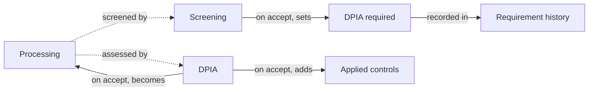

# DPIA and screening

A **data protection impact assessment** (DPIA) is the analysis GDPR Article 35 requires before a processing likely to result in a high risk to people's rights starts. A **screening**, or pre-DPIA, is the short check that decides whether a processing needs one.

CISO Assistant runs both on the [privacy register](privacy-register.md). It answers three questions a DPO is asked:

* Which processings need a DPIA, and why?
* Which of those have one, under way or accepted?
* What did each DPIA conclude, and which measures came out of it?


DPIAs are gated by the **DPIAs** feature flag, off by default. Turn it on under **Settings → Feature flags**. Screenings and DPIAs are [quick forms](quick-forms.md), so turning DPIAs on also turns on **Forms and Requests**.

Neither form needs a portal or a publication: both are started from the processing.


## Mental model

A **processing** is screened by a **screening**, a filled quick form. Once accepted, the screening sets the processing's **DPIA required** flag, and every change of that flag lands in the **requirement history**. A processing that requires one is then assessed by a **DPIA**, another quick form filled about the same processing. Once accepted, the DPIA becomes the processing's DPIA of record, and the measures it picked are added to the processing's applied controls.

| User-facing | Internal | Notes |
|---|---|---|
| Screening | `QuickFormResponse` | A response to a form whose **On accept** writes `processing.dpia_required` |
| DPIA | `QuickFormResponse` | A response to a form whose **On accept** writes `processing.dpia` |
| DPIA required | `Processing.dpia_required` | With who or what set it last (`dpia_required_source`) and when |
| DPIA requirement history | `DpiaRequirementChange` | Append-only, one row per change, whatever the path |
| DPIA of record | `Processing.dpia` | The last accepted DPIA |

## Only for controllers

A DPIA is the controller's duty (Art. 35). A processor only assists the controller with it (Art. 28(3)(f)).

So screenings and DPIAs apply to processings whose **GDPR role** is _Controller_ or _Joint Controller_. A processing in the [processor register](privacy-register.md#controller-and-processor-registers) has no DPIA card, does not appear on the DPIAs page, and cannot be screened. If a processing becomes a processor one while a screening or DPIA is open, accepting it writes nothing: the request says it **Does not apply to this object any more, so nothing will be written**.

## Screening

The **Pre-DPIA screening** library ships a screening form built on the nine WP29/EDPB criteria, as the CNIL applies them. It has three pages:

1. **Processing identification**: the processing, your role, the stage, the planned start date.
2. **WP29 criteria**: which of the nine criteria apply, a short justification, and an optional **Supporting document** (an email or a PDF backing the decision, such as the DPO's opinion).
3. **Exemptions**: only shown when two or more criteria are met. An exemption applies, for example, when an equivalent DPIA already exists.

Each criterion ticked scores one point, and the score decides the outcome:

| Outcome | When | Writes |
|---|---|---|
| **DPIA required** | Two or more criteria, no exemption | DPIA required |
| **DPIA recommended** | One criterion | DPIA required, shown with a **Recommended** badge: the form errs on the safe side |
| **No DPIA required** | No criterion, all answered | No DPIA required |
| **Exemption claimed — no DPIA required** | Two or more criteria, and an exemption applies | No DPIA required |

The form's **On accept** setting maps each outcome to a verdict. Your own screening form can do the same: any quick form whose **On accept** writes **DPIA required** is a screening form, and it shows on the DPIAs page under **Screening forms**. Such a mapping can also leave chosen outcomes to a reviewer.

The reviewer decides instead of the mapping when:

* an outcome left to review fired (**An exemption was claimed: the reviewer decides**);
* no mapped outcome fired (**No rule gave a verdict: the reviewer decides**);
* fired outcomes give different verdicts (**Rules disagree on the verdict: the reviewer decides**).

In every case the reviewer can override the verdict at acceptance, with a justification.

## Setting the requirement by hand

A DPO may decide without a screening, or against one. **Set manually** on the processing's **DPIA screening** card, or on a row of the processings list, sets **DPIA required** directly, with an optional reason kept in the history.

The card always says where the current verdict comes from:

<figure><figcaption>
The DPIA screening card: the verdict, where it comes from, and the DPIA
</figcaption></figure>

| Source | Card shows |
|---|---|
| An accepted screening | **Screened on** the date, with a link to the screening |
| A reviewer's override | **Adjusted at acceptance on** the date, with a link to the screening |
| A manual change | **Set manually on** the date |
| Nothing yet | **Not screened yet** |

The processing's **DPIA requirement history** tab lists every change: when, the new and previous verdict, the source, who made it, and the note. The history cannot be edited.

## The DPIA

The **Data protection impact assessment (DPIA)** library ships a DPIA form following the structure of the CNIL PIA method:

| Pages | What they ask |
|---|---|
| **Context** (overview; data, processes and supports) | Benefits and context, applicable standards, who accesses the data, its lifecycle, what it relies on |
| **Core principles** (proportionality and necessity; data subjects' rights) | Legitimacy of purposes, minimisation, accuracy, retention, information, consent, rights, contracts with processors, transfers |
| **Risks** (measures; illegitimate access; unwanted modification; disappearance; by-design risks) | For each of the three feared events: impacts, threats, risk sources, the measures treating it, severity and likelihood with a justification, and the residual severity and likelihood once planned measures are in place |
| **Validation** | The DPO's opinion and how it was applied, the data subjects' views, the decision and its conditions |

A DPIA is about one processing, and some of its pages show what the processing already records, read-only: personal data, data subjects and recipients on the data page, purposes on the proportionality page, contractors and transfers on the rights page, applied controls on the measures page. While the DPIA is a draft, they reflect the processing as it is; once submitted, as it stood then. The questions ask about what the register does not hold, rather than copying what it does.

### The privacy risk rating

Each risk page measures **Severity** and **Likelihood** on four levels, from _Negligible_ to _Maximum_. The form's **Privacy risk** rating crosses the two in a grid, so each risk gets a level: _Acceptable_, _To reduce_ or _Unacceptable_. The levels show for the current risk and, when the residual questions are answered, for the residual risk once the planned measures are in place.

When a residual risk stays _Unacceptable_, the DPIA fires **Residual risk unacceptable: consult the supervisory authority**, as Article 36 requires.

<figure><figcaption>
The Privacy risk grid on a DPIA's Results: each risk's Current risk and Residual risk
</figcaption></figure>

Ratings are a quick form feature: see [Scales and ratings](quick-forms.md#scales-and-ratings) to adapt the grid or build your own.

### Accepting a DPIA

A DPIA's **On accept** writes two things onto the processing:

* **DPIA**: the accepted response becomes the processing's DPIA of record.
* **Associated controls**: the measures the DPIA picked are added to the processing. Measures picked on a page that is hidden are left out, and so are measures from a domain the processing cannot reach. Accepting only adds: a control already on the processing stays.

A rejected DPIA is no DPIA: the card offers to start another one.

## The DPIAs page

**Privacy → DPIAs** shows where every controller processing you can see stands:

| State | Meaning |
|---|---|
| **DPIA required, none started** | The gap to close first |
| **DPIA required, under way** | A DPIA exists and is not accepted yet |
| **DPIA required, DPIA accepted** | Done |
| **No DPIA required** | Screened or set as not needing one |
| **Not screened yet** | No verdict at all |

<figure><figcaption>
Every controller processing by state, with its next step
</figcaption></figure>

Click a state to filter the list, and each row offers the next step: **Run DPIA screening**, **Start DPIA**, **Continue** an open DPIA, or **Review** a screening waiting for a decision. The side panel lists the **Screening forms** loaded.

## Related

* [Screening processings and running DPIAs](../guides/dpia.md): the step-by-step guide
* [Privacy register](privacy-register.md)
* [Quick forms and requests](quick-forms.md): review, separation of duties, writing back onto the subject
