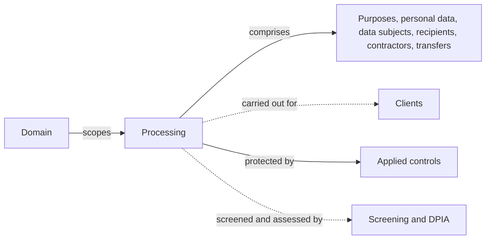
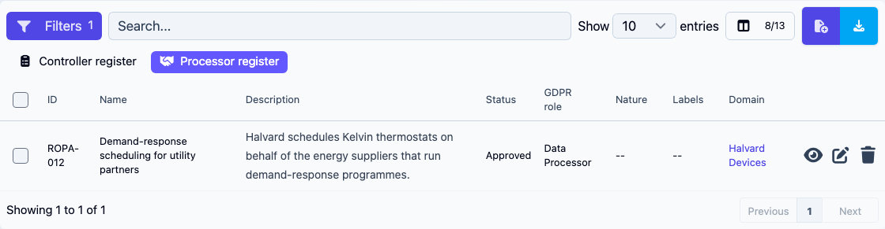

# Privacy register

A **privacy register** is the catalogue of personal-data processing activities the organisation carries out — required by GDPR and equivalent regulations as the foundation of accountable data handling.

CISO Assistant models the register as a graph of typed objects so it stays queryable, auditable, and reusable across audits.

## Mental model

A **processing** lives in a **domain** and comprises the records that describe it: its purposes, the personal data it handles, the data subjects, recipients, contractors and transfers. When you carry it out as a processor, or share it as a joint controller, it names the **clients** involved. Its security measures are **applied controls**. A controller processing can be screened, and assessed by a [DPIA](dpia.md) when it needs one.

| Object | What it records |
|---|---|
| **Processing** | An activity that operates on personal data (collect, store, transfer, delete). The central object |
| **Purpose** | The lawful reason a processing exists, with its legal basis. Each processing has at least one purpose |
| **Personal data** | What is being processed (name, email, location, health record, biometric, …), with categories that map to GDPR sensitivity classes |
| **Data subject** | The kind of individual the data refers to (employee, customer, prospect, …) |
| **Data recipient** | The internal teams or external parties that receive the data |
| **Data contractor** | Third parties that process data on your behalf — a TPRM entity surfaced here with a privacy-specific lens |
| **Data transfer** | Flows of data to entities outside the original jurisdiction |


Personal data entries can be created in batch from a processing's detail page: the **Batch create personal data** button (layer-group icon on the **Personal Data** table) opens a picker of categories grouped by theme — drawn from the [terminology](terminology.md) layer — and applies the same **Retention**, **Deletion Policy**, and **Is sensitive** values to every entry it creates. Categories the processing already records are skipped.


## Controller and processor registers

GDPR asks for two registers. A controller records the processings it decides on (Art. 30(1)). A processor records the processings it carries out on behalf of its clients (Art. 30(2)). Many organisations are both: a payroll provider is the controller of its own HR processing and a processor for its customers' payroll.

CISO Assistant keeps one list of processings and sets each one's **GDPR role**:

| GDPR role | Register | **Clients (controllers or processors)** |
|---|---|---|
| **Controller** (default) | Controller register, Art. 30(1) | Not asked |
| **Joint Controller** | Controller register, Art. 30(1) | The **Co-controllers** you share the processing with |
| **Data Processor** | Processor register, Art. 30(2) | The clients on whose behalf you carry it out. When you are a sub-processor, the processor that engaged you |

Clients are [third-party entities](third-party-risk.md), picked from the entities you can see.

On the **Processings** list, two quick filters switch between the registers: **Controller register** and **Processor register**. The list shows each processing's **GDPR role**, and its **Clients (controllers or processors)** among the optional columns. A processing added while **Processor register** is selected starts as a processor one.

<figure><figcaption>
Processor register selected: the processings carried out for clients
</figcaption></figure>

A processor processing has no DPIA fields: the DPIA is the controller's duty. See [DPIA and screening](dpia.md#only-for-controllers).

## DPIA

Each controller processing records whether it needs a data protection impact assessment, with the reference of its DPIA. When the **DPIAs** feature flag is on, the processing's detail page gains a **DPIA screening** card: it runs a screening to decide, sets the verdict by hand, starts the DPIA, and keeps the history of every decision. **Privacy → DPIAs** follows the whole register.

See [DPIA and screening](dpia.md), and the [step-by-step guide](../guides/dpia.md).

## Event objects

Privacy operations also need to record events as they happen:

- **Right requests** — data-subject requests under GDPR (access, rectification, erasure, portability) and the organisation's response.
- **Data breaches** — incidents affecting personal data, with the notification clock and authority correspondence. A breach can point at an [incident](incidents.md). In the **Incident** field, typing a name that matches no incident offers **✨ Create incident "…"**: saving the breach creates that incident in the breach's domain, or reuses one with the same name there. Saving it needs the right to add incidents in that domain.

## How it ties into the rest of the platform

- A privacy register lives in a **domain** with its own RBAC scoping — typically a DPO-led folder.
- Findings from GDPR audits surface in the register as actions on processings.
- Data contractors and clients cross-reference TPRM entities, so a sub-processor's security review feeds both worlds.
- A processing's **nature** and its personal-data **categories** draw from the [terminology](terminology.md) layer, so you can align them to your own internal vocabulary.
- A processing can be exported as a multi-sheet Excel workbook from its detail page and re-imported — through the data import wizard or the CLI — to recreate it with all its sub-objects. See [Data import](../configuration/data-import.md#processings).

## Related

- [DPIA and screening](dpia.md)
- [Domains](domains.md)
- [Third-party risk](third-party-risk.md)
- [Terminology](terminology.md) — customise processing nature and personal-data category labels
- [Vocabulary → Processing / Personal data / Purpose / Right request / Data breach](../introduction/vocabulary.md)
