# Active Directory Federation Service (AD FS)


<mark style="color:red;">Self-signed certificates won't work with CISO Assistant (even on a locally tested instance). On the other hand, certificates issued by Active Directory Certificate Services (AD CS) will work.</mark>


Open your **Server Manager**

1. Click **Tools > AD FS Management**

    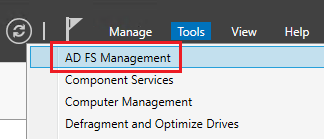

2. Click **Relying Party Trust**
3. Click **Add Relying Party Trust...** 

    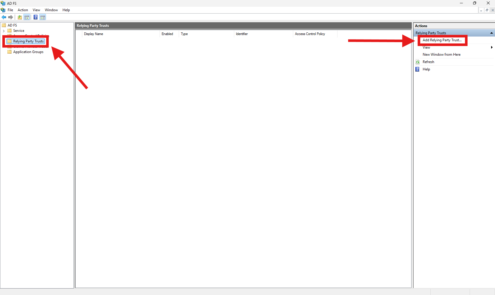

4. A Wizard opens. Select **Claims Aware**
5. Click **Start**

    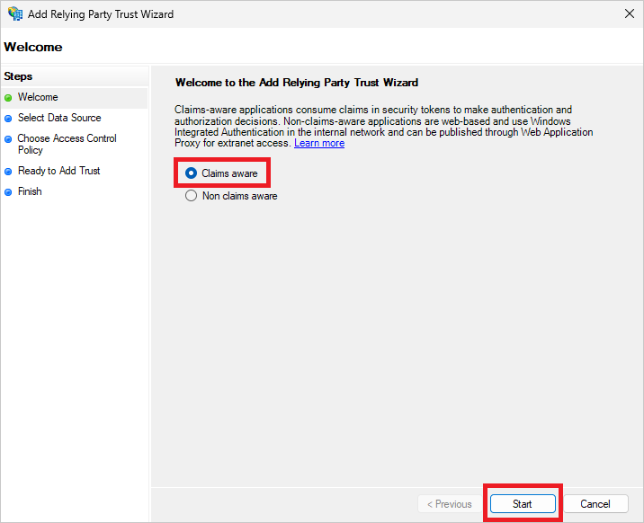

6. Select **Enter data about the relying party manually**
7. Click **Next >**

    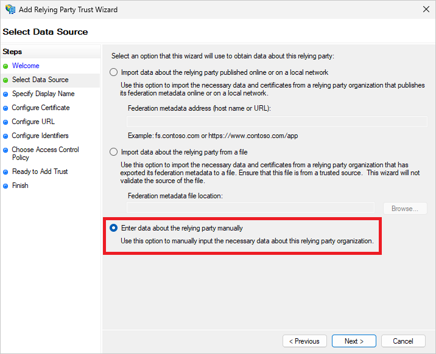

8. Set the **Display Name :** CISO Assistant
9. Click **Next >**

    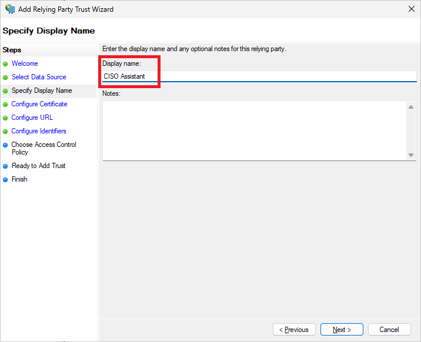

10. Click **Next >**

    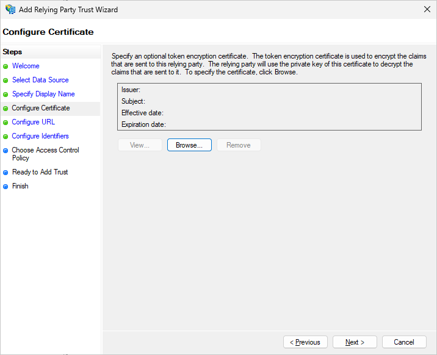

11. Click **Enable support for the SAML 2.0 WebSSO protocol**
12. Enter the **Relying party SAML 2.0 SSO service URL:** `<ciso_backend_url>/api/accounts/saml/0/acs/` (for example with localhost: `https://localhost:8443/api/accounts/saml/0/acs/`)
13. Click **Next >**

    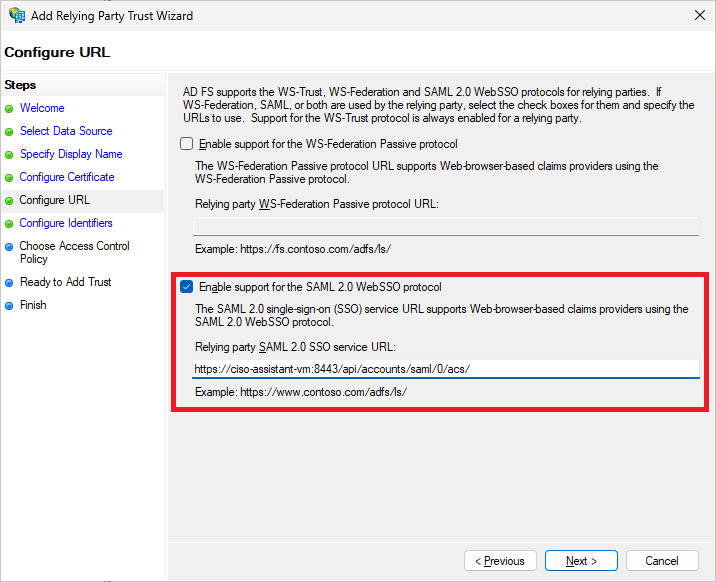

14. For this step, open CISO Assistant, go to SSO settings and copy the **SP Entity ID** you've set earlier

    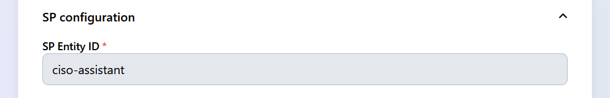

15. Go back to the Wizard an paste the SP Entity ID in the **Relying party trust identifier** field
16. Click **Add**
17. Click **Next >**

    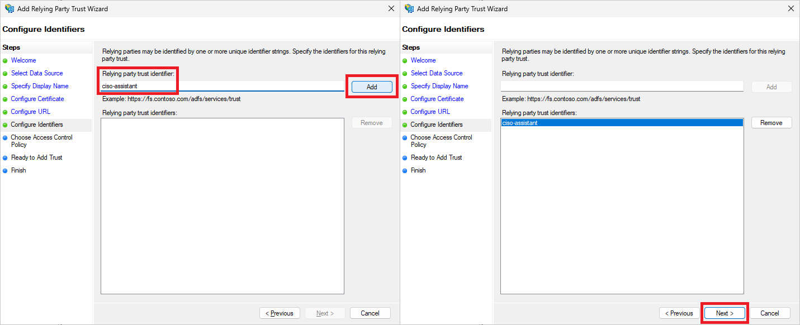

18. Choose your preferred **Access Control Policy**

You can skip this step if you're in a test environment, but please keep in mind that it's strongly recommended that you configure your **Access Control Policy** correctly on a production server.

19. Click **Next >**

    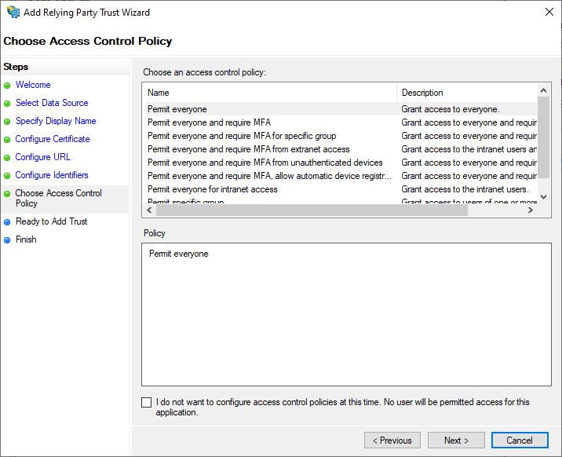

20. Click **Next >**

    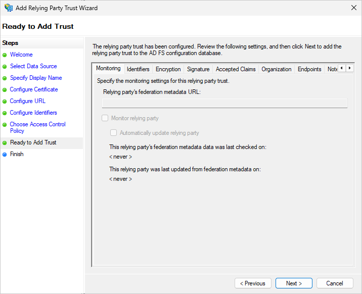

21. Click **Close**

    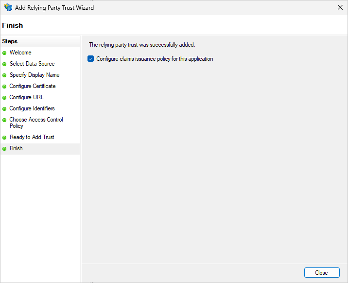

22. A new window opens. Click **Add Rule**

    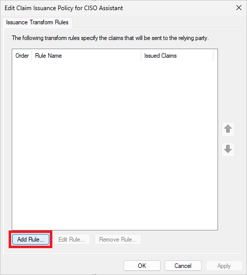


If for some reason this window didn't open itself automatically, go back on **AD FS Management**, click **Relying Party Trust**, right-click **CISO Assistant**, then click **Edit Claim Issuance Policy...**


    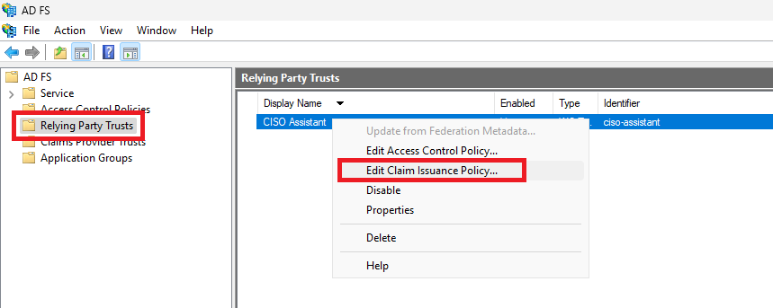

23. A Wizard opens. For **Claim rule template**, select **Send LDAP Attributes as Claims** in the drop-down menu.
24. Click **Next >**

    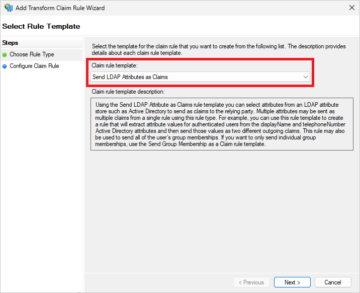

25. Set the **Claim rule name :** Main Rule
26. Select **Active Directory** in the drop-down menu for **Attribute store**
27. Fill the **Mapping of LDAP attributes to outgoing claim types** as shown with the help of the drop-down menus
28. Click **Finish**

    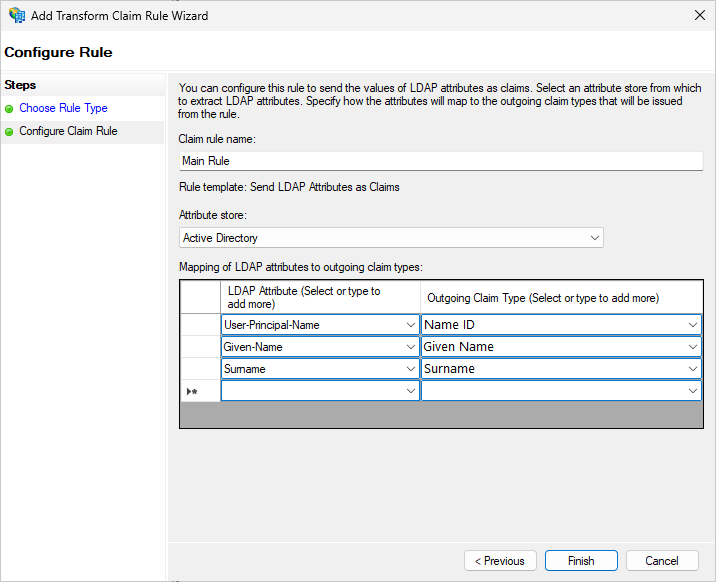

29. Click **Apply** then **OK**

    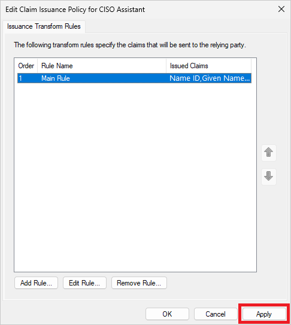

30. Go back to **AD FS Management** and click **AD FS**
31. Click **Edit Federation Service Propertie...**

    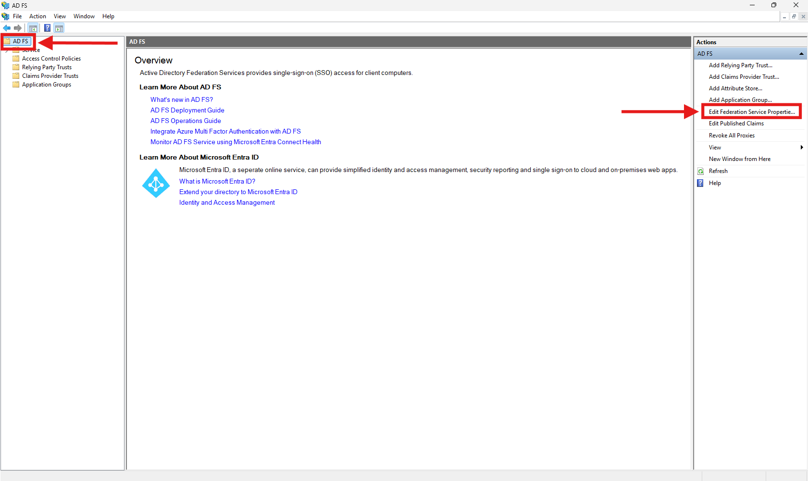

32. A window opens. Copy the **Federation Service identifier** as it is the <mark style="color:purple;">**IdP Entity ID**</mark>  in CISO Assistant

    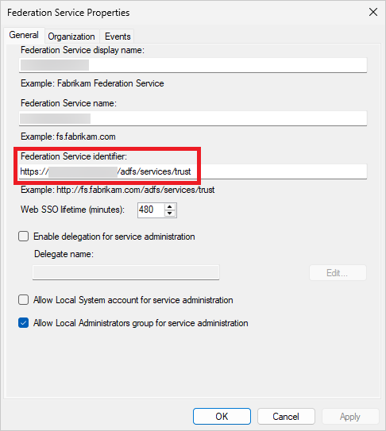

33. Click **Service > Endpoints** and search for the endpoint of type **SAML 2.0/WS-Federation**. The **URL Path** of the endpoint corresponds to the end of the URL for the **SSO URL** and **SLO URL** in CISO Assistant. You must combine your domain name with this URL for <mark style="color:purple;">**SSO URL**</mark> and <mark style="color:purple;">**SLO URL**</mark> in CISO Assistant (for example if your domain name is `super.server.com`, the URL will be `https://super.server.com/adfs/ls/` in our case)

    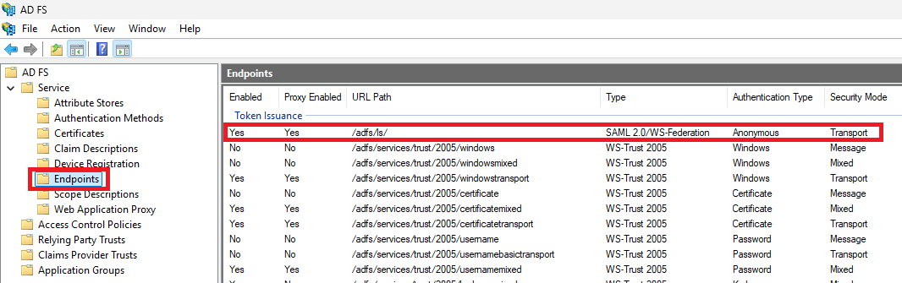

34. Click **Service > Certificates** ans double-click the primary certificate in the **Token-signing** section

    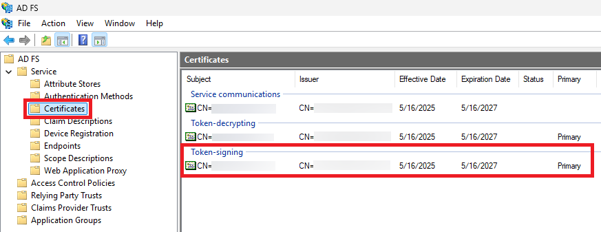

35. A window opens. Click on the **Details** tab
36. Click **Copy to File...** 

    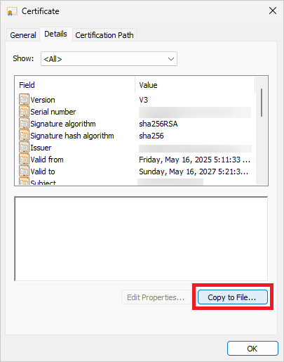

37. A Wizard opens. Click **Next**
38. If requested, select **No, do not export the private key** and click **Next**

    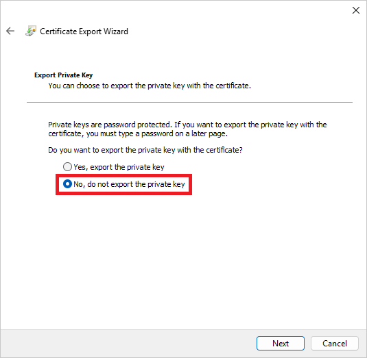

39. Select **Base-64 encoded X.509 (.CER)** and click **Next**

    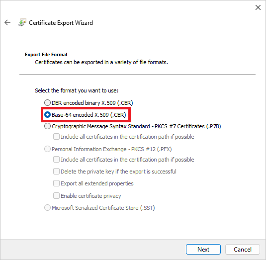

40. Select a location to store the certificate (in your Desktop for example) by clicking on **Browse** and click **Next**

    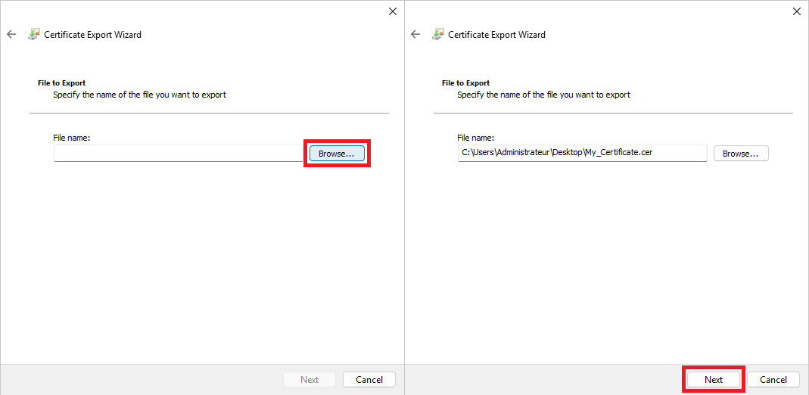

41. Click **Finish**. This window should appear. Click **OK**

    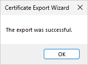

42. Go to the location where you exported the certificate
43. Right-click the certificate and click **Open with > Choose another app**
44. Select **Notepad**. You should see something like this

    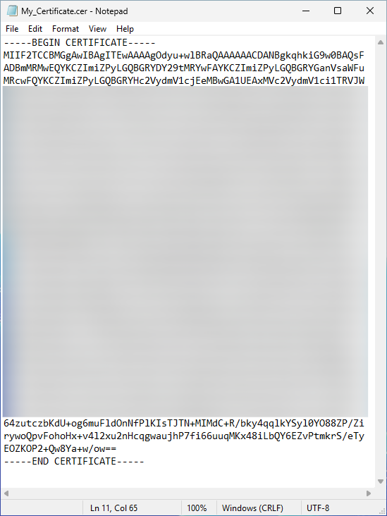

45. Copy absolutely everything in the file as it is the <mark style="color:purple;">**x509 certificate**</mark> in CISO Assistant

## If you get an error when logging in with SSO

It may happen that when you click on **Login with SSO** on CISO Assistant login page after completing configuration, it throws you an error.
To solve this problem, go to SSO settings in CISO Assistant. In the **Advanced settings** section, check the **Allow single label domains** option. It should then work correctly.

    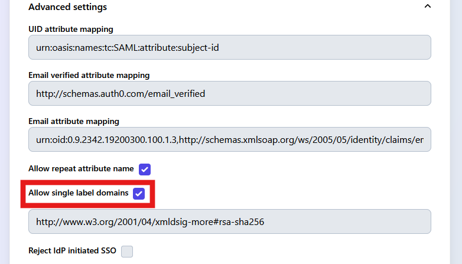

## I want to log in from the AD FS Login Portal

If you want to be able to log in directly from the AD FS Login Portal, go to SSO settings in CISO Assistant.
In the **Advanced settings** section, uncheck the **Reject IdP initiated SSO** option.

    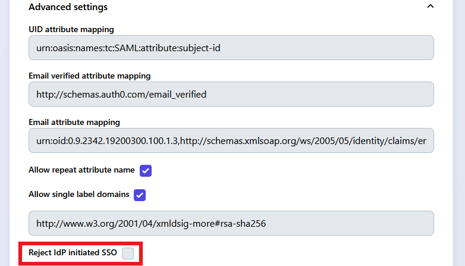

