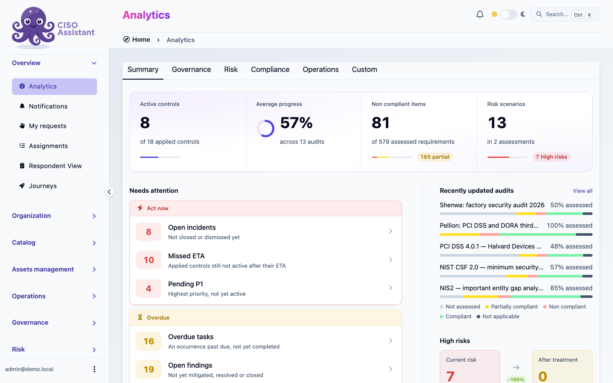
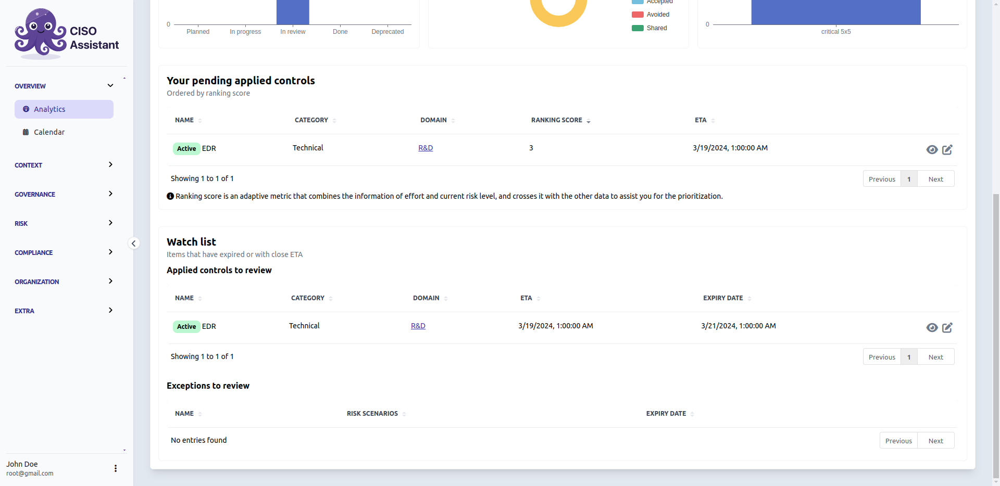

# Analytics

The main page to track your perimeters over time. It opens on the **Summary** tab, a briefing of what needs attention; the **Governance**, **Risk**, **Compliance**, **Operations** and **Custom** tabs go deeper.

## Summary

The **Summary** tab is built to be read in a minute.

**Needs attention** lists only the items with something to act on, grouped by urgency. Each one shows its count and opens the matching filtered list:

| Group | Items |
|---|---|
| **Act now** | **Open incidents** (not closed or dismissed yet), **Missed ETA** (applied controls still not active after their ETA), **Pending P1** (highest priority, not yet active) |
| **Overdue** | **Overdue tasks** (an occurrence past due, not yet completed), **Open findings** (not yet mitigated, resolved or closed), **Expired evidences** (past their validity date) |
| **Housekeeping** | **Controls without a status**, **Degraded controls** (were active, no longer performing as intended) |

When nothing qualifies, it reads _Nothing needs your attention right now._

Below, the headline figures, each with a trend line once a few days of daily snapshots exist:

- **Active controls**, out of all applied controls, with the change since the first snapshot (_+3 since 12 Oct_).
- **Average progress** of the audits, and **Non compliant items** out of the assessed requirements.
- **Risk scenarios**, with the number of **High risks**: scenarios at the top levels of their own matrix.

Beside the list, **Recently updated audits** shows each audit's results bar (with **View all**), and **High risks** sets the number of high scenarios at **Current risk** against the number left **After treatment**.

<figure><figcaption>
The <strong>Summary</strong> tab: headline figures, <strong>Needs attention</strong> grouped by urgency, recently updated audits and high risks
</figcaption></figure>

## Governance

At the bottom of the governance tab, you'll find an applied-controls ranking score and a watch list to warn you about upcoming deadlines on applied controls or risk acceptances.


The applied-controls ranking score table is there to help you prioritise.


