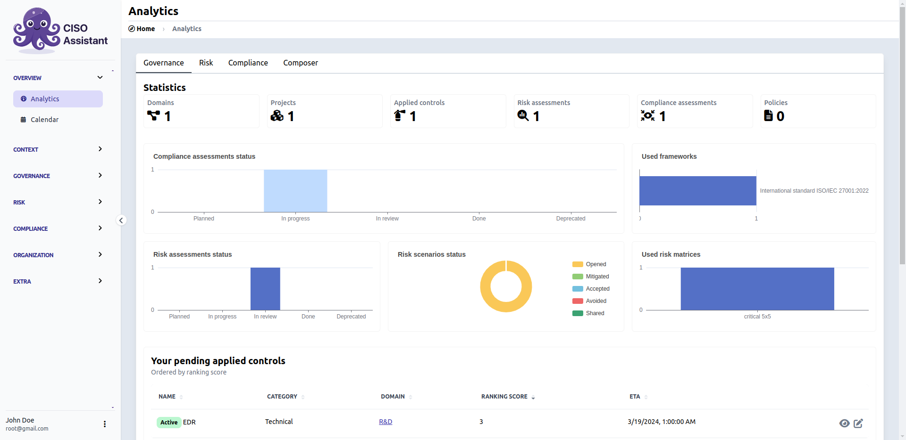

# Analytics

The main page to track your perimeters over time. It opens on the **Summary** tab, a briefing of what needs attention; the **Governance**, **Risk**, **Compliance**, **Operations** and **Custom** tabs go deeper.

## Summary

The **Summary** tab is built to be read in a minute.

At the top, the headline figures, each with a trend line once a few days of daily snapshots exist:

- **Active controls**, out of all applied controls, with the change since the first snapshot (_+3 since 12 Oct_).
- **Average progress** of the audits, and **Non compliant items** out of the assessed requirements.
- **Risk scenarios**, with the number of **High risks**: scenarios at the top levels of their own matrix.

Below, **Needs attention** lists only the items with something to act on, grouped by urgency and most urgent first. Each group shows three items; when more qualify, **+N more** at the bottom of the group reveals the rest. Each item shows its count and opens the matching filtered list:

| Group | Items |
|---|---|
| **Act now** | **NIS2 deadlines missed** (significant incidents past a NIS2 reporting deadline), **Open incidents** (not closed or dismissed yet), **Vulnerabilities past SLA** (not resolved by their SLA due date), **Right requests due** (due within 7 days or already late), **Missed ETA** (applied controls still not active after their ETA), **Pending P1** (highest priority, not yet active) |
| **Overdue** | **Lapsed risk acceptances** (accepted, but past their expiry date), **Lapsed security exceptions** (still approved past their expiration date), **Overdue tasks** (an occurrence past due, not yet completed), **Overdue audits**, **Overdue risk assessments** and **Overdue third-party assessments** (past their due date, not done yet), **Open findings** (not yet mitigated, resolved or closed), **Expired evidences** (past their validity date) |
| **Coming up** | **Evidences expiring soon** (validity ends within 30 days), **Contracts ending soon** (active, ending within 30 days) |
| **Housekeeping** | **Evidences to review** (a new version is waiting for review), **Controls without a status**, **Degraded controls** (were active, no longer performing as intended) |

A few things to keep in mind when reading it:

- An item with a count of zero is hidden, and so is a group with no items left.
- Counts cover only the objects you can view.
- Deprecated items are left out. So are draft assessments (audits, risk assessments, third-party assessments and findings assessments with no status), along with their findings, requirements and risk scenarios: this applies to the headline figures and **Recently updated audits** too. Other items with no status yet, such as applied controls, still count: nothing has been started on them.
- Items belonging to a module that is turned off in the feature flags are hidden: incidents, NIS2, vulnerabilities, right requests, risk acceptances, security exceptions, tasks, audits, risk assessments, third-party assessments, contracts and findings.
- **NIS2 deadlines missed** looks at the next open stage of each significant incident: the early warning (24 hours), the incident notification (72 hours) or the final report (one month). Dismissed incidents are left out.
- **Overdue tasks** counts task definitions with at least one overdue occurrence, not the occurrences themselves.
- The same applied control can appear in several rows: a degraded P1 control past its ETA counts in **Missed ETA**, **Pending P1** and **Degraded controls**.
- Some rows show a trend line once a few days of daily snapshots exist.

When nothing qualifies, a green card reads _Nothing needs your attention right now._

Beside the list, **Recently updated audits** shows each audit's results bar (with **View all**), and **High risks** sets the number of high scenarios at **Current risk** against the number left **After treatment**.

<figure><figcaption>
The <strong>Summary</strong> tab: headline figures, <strong>Needs attention</strong> grouped by urgency, recently updated audits and high risks
</figcaption></figure>

## Governance

At the bottom of the governance tab, you'll find an applied-controls ranking score and a watch list to warn you about upcoming deadlines on applied controls or risk acceptances.


The applied-controls ranking score table is there to help you prioritise.


