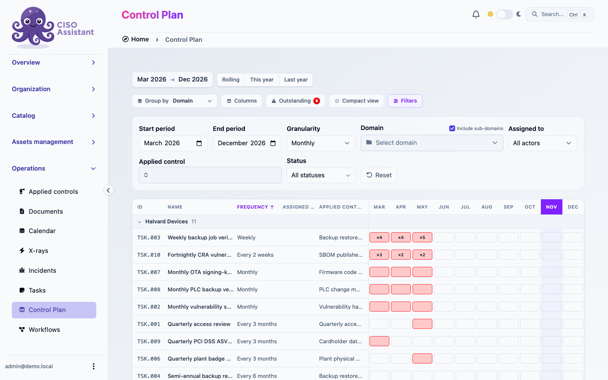

# Control Plan

The **Control Plan** is the calendar-style heat-map of your recurrent operational work. Each cell is a task occurrence — colour-coded by status — laid out across time, so a quarter's worth of weekly access reviews or monthly backup tests is visible as one strip. It's the answer to _"are we actually running our recurring controls on cadence?"_

## Where to find it

Sidebar → **Control Plan** (under the Overview group).

The page is gated by the `control_plan` feature flag, **default on** — so it ships visible in both community and Enterprise editions unless an admin disables it.

## Layout

The body is a grid:

- **Columns** — time periods, **Weekly**, **Monthly** (default), **Quarterly** or **Semiannual**, from the **Granularity** filter. Quarters and halves are labelled `Q1`…`Q4` and `H1`/`H2`. The **Current period** is highlighted.
- **Rows** — task definitions (one row per recurring task definition), with columns you can show, hide and reorder from **Columns**: reference ID, name, frequency, next occurrence, assigned to, applied control and domain. Click a column header to sort on it; drag the edge of the task columns to resize them.
- **Cells** — one per occurrence, colour-coded by status:

| Status | Cell colour |
|---|---|
| Completed | Green |
| In progress | Violet |
| Pending | Red |
| Cancelled | Gray |
| No occurrence in this period | Dashed white |

When a period holds several occurrences, such as a weekly task in monthly view, the cell shows their count (`×4`). A glance gives you the run rate; clicking a cell jumps into the corresponding task occurrence.

<figure><figcaption>
The Control Plan grouped by <strong>Domain</strong>, with the <strong>Filters</strong> panel open and the current period highlighted
</figcaption></figure> Open a task definition to see the history of its occurrences, period by period.

## Period

Without a chosen period, the page follows today: **Rolling** shows a little of the past and mostly what is ahead (two periods back and nine ahead in monthly or weekly view, one back and three ahead in quarterly). **This year** and **Last year** jump to a calendar year; **Start period** and **End period** set any range.

## Grouping and focus

- **Group by** — **Domain**, **Frequency**, **Assigned to**, or **No grouping**.
- **Outstanding** — keep only the tasks that need action now: an overdue occurrence, or one still open in the current period. Its badge counts them.
- **Compact view** — narrower rows and periods, to fit dozens of task definitions on screen.

Columns, sort, grouping and compact view are remembered in your browser.

## Filters

The **Filters** panel narrows the grid:

- **Domain**, with **Include sub-domains** to take the domains below it too.
- **Assigned to** — by actor.
- **Applied control** — occurrences that maintain a specific control.
- **Status** — the status aggregated over each period.

The filter button shows an active-filter count. **Reset** clears all filters and goes back to the rolling period.

## Related

- [Tasks](../concepts/tasks.md) — the template / occurrence model that this page rolls up
- [My assignments](my-assignments.md) — your personal slice of what's due
- [Notifications](notifications.md) — get pinged before a task goes overdue
- [Sync to actions](sync-to-actions.md)
- [Feature flags](../configuration/settings/feature-flags.md)
