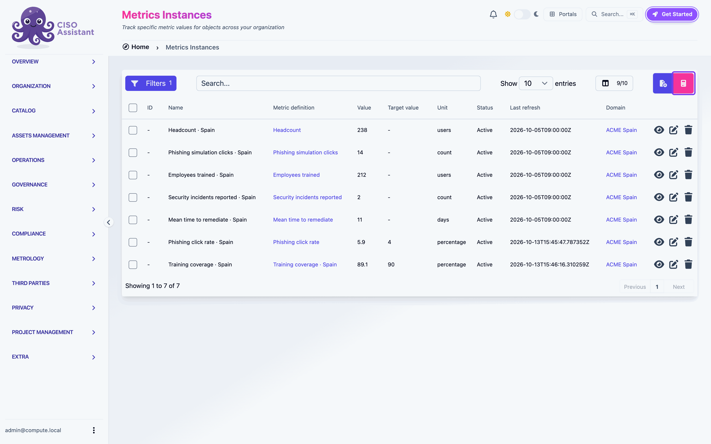
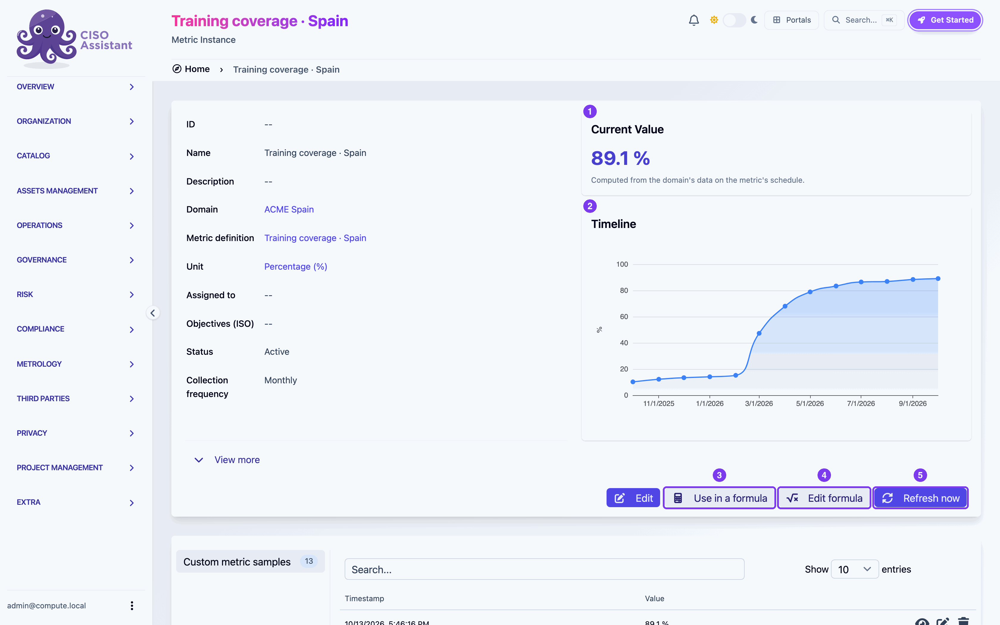

# Computed metrics

A computed metric is a metric instance nobody fills in. Its value comes from a formula over other metrics, the way a spreadsheet cell computes from other cells: a training coverage from the employees trained and the headcount, a phishing click rate from the clicks and the people tested, a risk level from a threshold on any of them.

You start from the metrics you already track. Pick them, write the formula, name the result: the application creates the metric and the definition behind it, computes its whole history from the existing samples, and keeps it up to date on its schedule.

## Where to start

There are three ways in, all opening the same **New computed metric** window. See [Create a computed metric](creating.md).

| From | Do this | The window opens with |
|---|---|---|
| **Metrology > Metric instances** | Click the calculator button next to the **+** button | Nothing picked yet |
| A selection in that list | Tick the metrics, then **Compute from selection** | The selected metrics, in the order you ticked them |
| A metric's page | **Use in a formula** | That metric, already in the formula |

<figure><figcaption>
The calculator button opens the New computed metric window
</figcaption></figure>

## Reading a computed metric

A computed metric's page looks like any other metric's, with a few differences.

<figure><figcaption>
A computed metric: 1 current value, 2 timeline, 3 Use in a formula, 4 Edit formula, 5 Refresh now
</figcaption></figure>

1. **Current Value**: the latest result, with the note "Computed from the domain's data on the metric's schedule." When the last computation failed, its error shows here as **Last computation error**.
2. **Timeline**: one point per period, from the first period its inputs have data for.
3. **Use in a formula**: starts a new computed metric that reads this one. Only numbers can be read by a formula, so this button does not show on a metric whose result is a level.
4. **Edit formula**: opens the formula in a drawer beside the page. See [Edit a formula](editing.md).
5. **Refresh now**: recomputes the metric's whole series right away instead of waiting for its schedule. The button spins while the worker computes, then the value, the chart and the samples update in place.

A computed metric has no button to add a sample: its samples come from its formula only. They are not typed in, imported or written by a workflow.

## Where the formula lives

Every metric instance has a [metric definition](../../concepts/metrics.md#metric-definitions), and a computed metric's formula belongs to its definition. The New computed metric window creates that definition for the metric, or reuses an identical one when it already exists, so the same indicator computed in several domains shares one definition.

Editing the formula never changes another metric: if other metrics share the definition, the one you edit gets a copy of its own when you save. See [Edit a formula](editing.md).

## In this section

- [Create a computed metric](creating.md): the New computed metric window, step by step
- [Edit a formula](editing.md): the drawer, the before/after chart, shared definitions
- [Formula reference](formulas.md): the language, periods, missing values, levels
- [Troubleshooting](troubleshooting.md): messages and what to do about them

New to metrics? Read the [Metrics concept page](../../concepts/metrics.md) first, or follow [Creating your first computed metric](../../guides/first-computed-metric.md).
