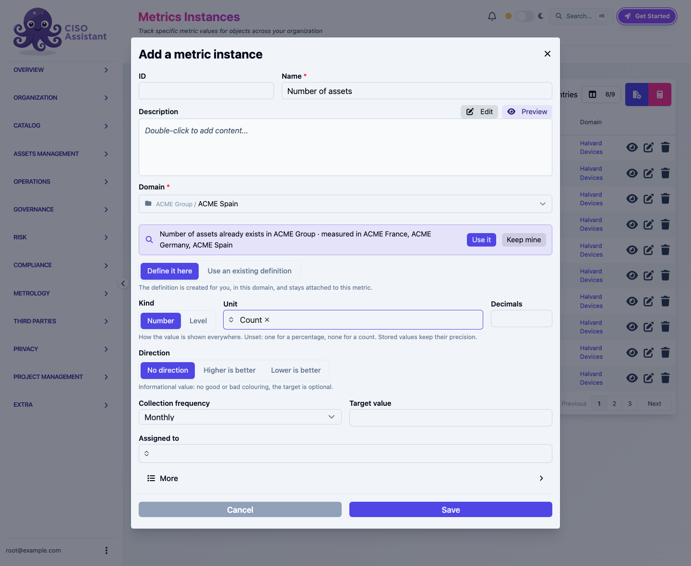
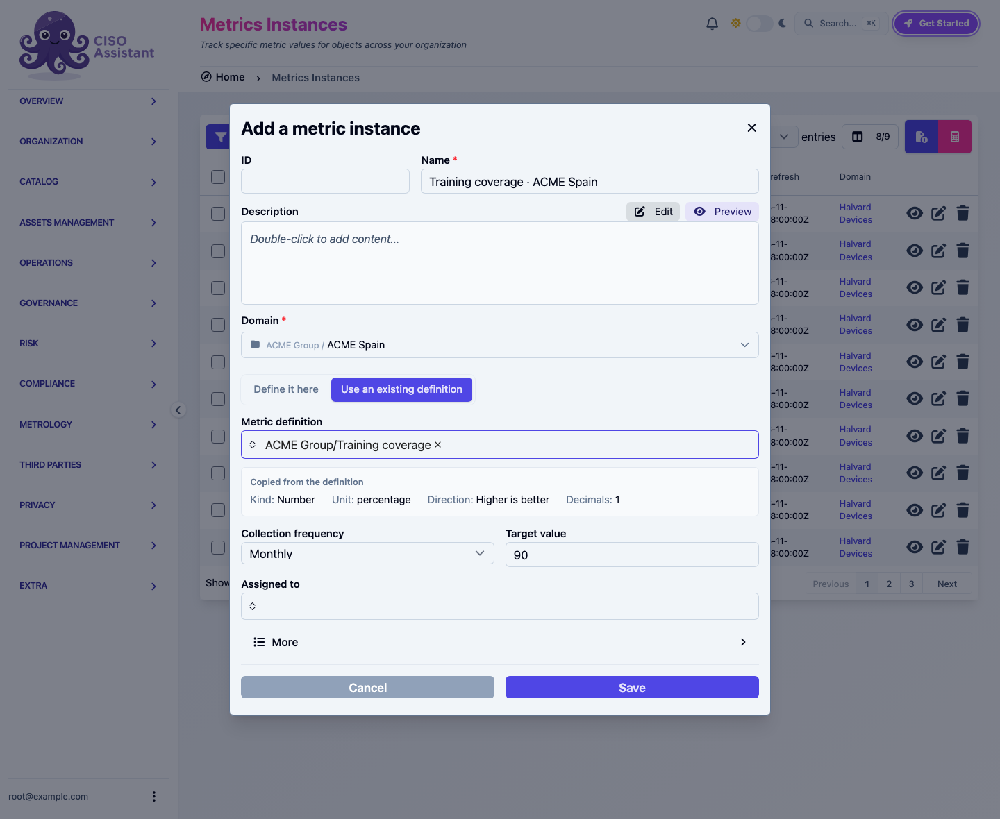
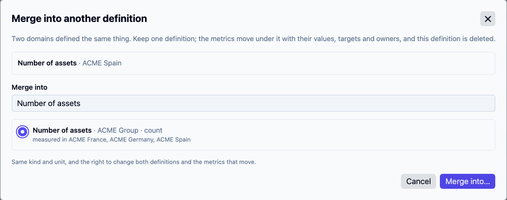

# Create a metric

A metric is created in one form, from **Metrology > Metric instances** with the **+** button. The definition behind it is created with it, in the metric's domain, named after it. You do not need to create a metric definition first.

<figure><figcaption>
One form: the name, the domain, the kind and unit, the direction. The hint offers a definition that already exists higher up
</figcaption></figure>

## Define it here

The default. Fill in:

| Field | What to know |
|---|---|
| **Name** | The metric's name. Its definition gets the same name, with a number added when the domain already has a definition by that name |
| **Domain** | Where the metric and its definition live |
| **Kind** | **Number**, with a **Unit** and **Decimals**, or **Level**, with an ordered list of levels. See [Levels](creating.md#levels) |
| **Decimals** | How many decimals the value shows, everywhere it is shown. Leave it empty for the unit's default: one for a percentage, none for a count, as entered for other units. The stored value keeps its precision |
| **Direction** | **No direction**, **Higher is better** or **Lower is better**. See [Direction](#direction) |
| **Collection frequency** | How often a value is expected. It also sets the period a recorded value answers for. See [Record a value](recording-values.md) |
| **Target value** | Optional. A metric with no direction can still have one |
| **Owner** | Who records the values. Defaults to you |

**Save** opens the new metric's page, ready for its first value.

You need the right to add both metric instances and metric definitions in the domain. The definition is created in the same transaction as the metric: a refused metric leaves no definition behind.

### A similar definition already exists

While you type the name, the form looks for a definition you can read with a similar name and the same kind, and shows it under the field with the domains that measure it. **Use it** switches the form to the existing-definition mode with that definition picked; **Keep mine** hides the hint for that name.

The hint only reaches definitions you can read: library definitions, global ones, and those of the domains above yours. Two sibling domains that define the same metric independently are not caught here; the fix is a [merge](#merge-two-definitions) by someone who sees both.

## Use an existing definition

Pick **Use an existing definition** when the metric exists as a definition already: one from a library such as ISO 27004, or one defined at group level and measured in other domains.

<figure><figcaption>
The name follows the definition and the domain; the kind, unit, direction and decimals come from the definition
</figcaption></figure>

- The **Name** is suggested as *Definition · Domain* and follows both until you type one.
- **Copied from the definition** shows the kind, unit, direction and decimals the metric takes. The definition's default collection frequency and target, when it has them, fill the fields below.
- The picker only offers definitions you can read.

Opening the form from a definition's page starts in this mode, with that definition picked.

## Direction

A definition's direction decides how a change reads:

| Direction | Means | On widgets and trends |
|---|---|---|
| **No direction** | The value is informational: a count of assets, a headcount | No green or red; the target is optional |
| **Higher is better** | A rise is good news: a compliance score | A rise shows green, a drop red |
| **Lower is better** | A drop is good news: open vulnerabilities, time to remediate | A drop shows green, a rise red |

New definitions have no direction unless you choose one. Definitions created before this choice existed keep **Higher is better**.

For a level metric, the direction reads the order of the levels: with **Higher is better** the last level is the best.

## Merge two definitions

When two domains defined the same metric separately, keep one definition and move the metrics under it. On the definition to drop, open **Merge into…**.

<figure><figcaption>
The candidates share the definition's kind and unit; the chosen one keeps its direction, decimals and defaults
</figcaption></figure>

- The list offers definitions you can read with a similar name, the same kind and the same unit. Search for another name if needed.
- **Merge into…** moves every metric of this definition under the chosen one, with its values, target, owner and collection task, then deletes this definition. Dashboards and formulas reading those metrics keep working. The kept definition's direction, decimals and defaults apply from then on.
- A level definition only merges with one that has the same levels, in the same order, since a level value is an index into that list.
- A definition from a library, one with a formula, or one that a formula reads cannot be merged away.
- You need the right to change and delete the definition you drop, to change the one you keep, and to change each metric that moves.

A merge cannot be undone, but nothing is lost: every value keeps its period and its evidence.
