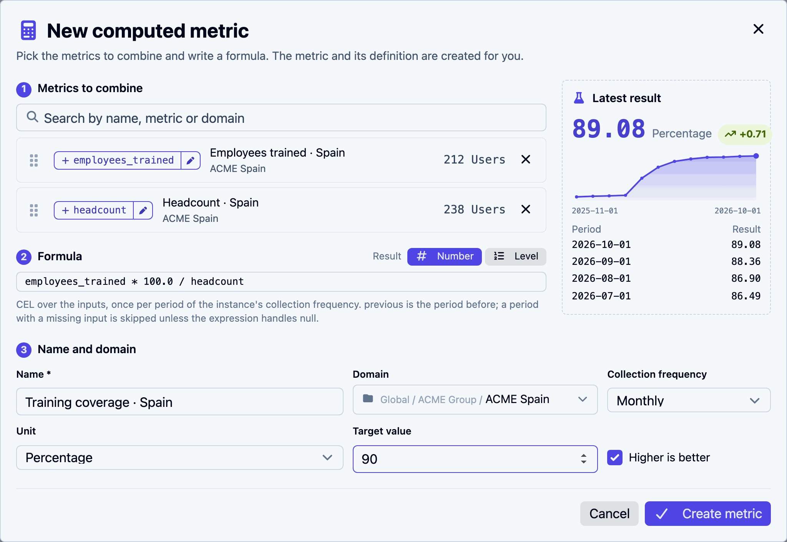
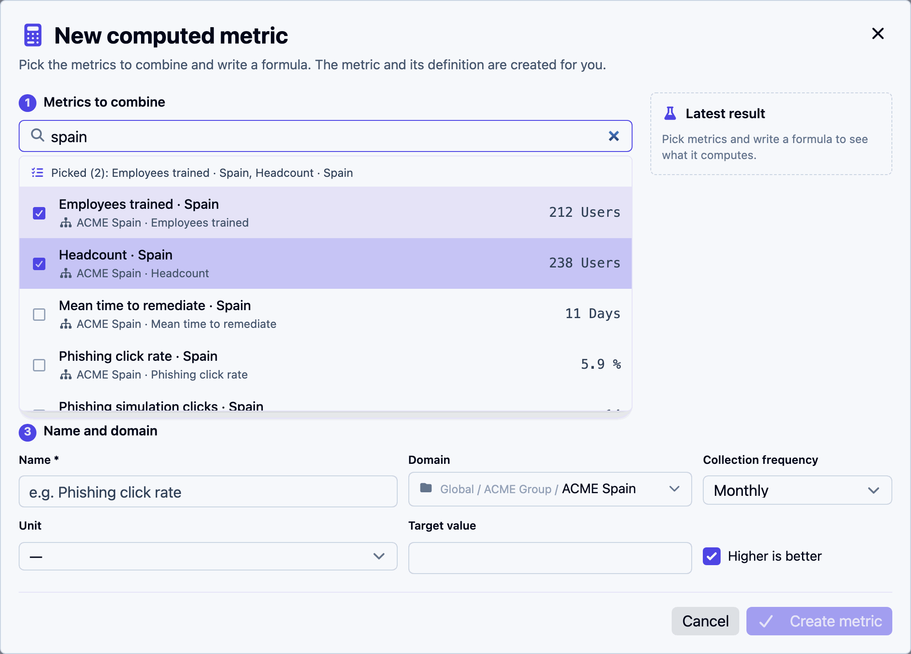
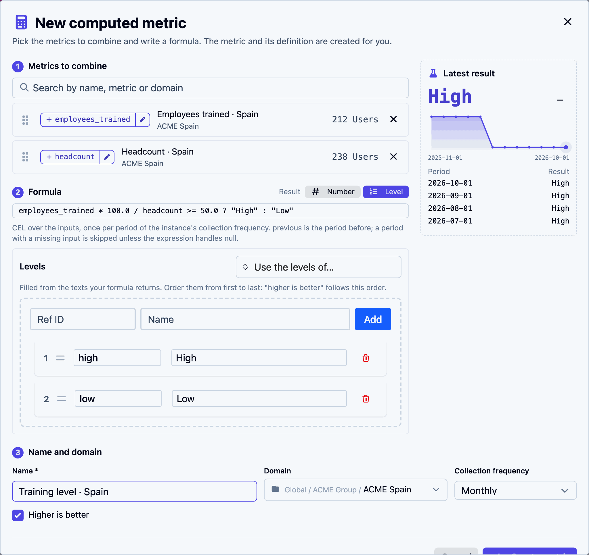

# Create a computed metric

The **New computed metric** window turns metrics you already track into a new one. It has three numbered steps and a live result on the right. Nothing is saved until you click **Create metric**.

<figure><figcaption>
Two metrics, a ratio, and the result before anything is saved
</figcaption></figure>

Open it from **Metrology > Metric instances** (the calculator button), from a selection in that list (**Compute from selection**), or from a metric's page (**Use in a formula**). See [Where to start](README.md#where-to-start).

You need the right to add both metric instances and metric definitions in the domain the new metric will live in.

## 1. Metrics to combine

Search for the metrics the formula reads. Each word you type must appear in the metric's name, its definition's name or its domain: `clicks france` finds *Phishing simulation clicks · France*.

<figure><figcaption>
Picked metrics stay in the list, ticked; the line at the top sums them up
</figcaption></figure>

- Click a result, or press **Enter** on the highlighted one, to pick it. Click it again to remove it. The list stays open: keep typing to add the next one.
- **↑** and **↓** move through the list. **Escape** closes it.
- Only numeric metrics are offered, never deprecated ones, and only those you may view.
- A formula reads at most 20 metrics.

Each picked metric becomes a row:

| Part | What it does |
|---|---|
| Grip (⋮⋮) | Drag to reorder. With the grip focused, **↑** and **↓** move the row. The order matters to the quick formulas: a ratio divides the first metric by the second |
| Name chip, such as `+ employees_trained` | The name the formula uses for this metric. Click it to insert the name into the formula |
| Pencil | Renames it. The formula follows the new name. A name starts with a letter or `_`, holds letters, digits and `_`, and cannot be `previous`, `metrics`, `now` or `today` |
| Value | The metric's current value, to check you picked the right one |
| ✕ | Removes it |

Names are made from the metric's definition: *Employees trained* becomes `employees_trained`. Two picks of the same kind get `_2`, `_3` and so on.

## 2. Formula

Write the formula in the field, using the names from step 1. Suggestions appear as you type, with each name's current value.

**Result** decides what the metric holds:

- **Number**: a quantity, such as a percentage, a count or a duration.
- **Level**: one of an ordered list of texts, such as *High* and *Low*. See [Levels](#levels).

When the formula is empty, **Start from:** offers ready-made formulas over your picks:

| Quick formula | Offered with | Gives |
|---|---|---|
| **Ratio (%)** | exactly two metrics | `first * 100.0 / second` |
| **Difference** | exactly two metrics | `first - second` |
| **Sum** | two or more | every pick added up |
| **Average** | two or more | the sum divided by the number of picks |
| **Threshold** | a level result, one or more | `first >= 50.0 ? "High" : "Low"`, or the ratio of the first two against 50, to adjust |

The formula runs once per period of the metric's collection frequency, with each input's value for that period. `previous` is the result of the period before. The [Formula reference](formulas.md) covers the language: arithmetic, conditions, missing values and the available functions.


Write `100.0`, not `100`, when a division must keep its decimals. Two whole numbers divide into a whole number: `212 / 238` is `0`, while `212 * 100.0 / 238` is `89.07…`. The quick formulas already do this.


### Levels

Choose **Result: Level** and the formula returns texts. The **Levels** box lists them, filled from the texts in your formula as you type.

<figure><figcaption>
A threshold turned into levels: the list follows the texts the formula returns
</figcaption></figure>

- Each level has a **Ref ID** and a **Name**. The formula may return either.
- Order the levels from first to last by dragging them. **Higher is better** reads this order: ticked, each level is better than the one before it, so the last is the best; unticked, the first is the best. It decides whether a change of level shows as good or bad news.
- Rename a level and the formula's text follows.
- **Use the levels of…** copies the levels of an existing level metric, so several metrics share one scale. After that, the list no longer follows the formula: write the formula to return those names or references.
- A text the formula returns that is not a level shows a warning, such as *'Medium' is not one of the levels*.

A metric whose result is a level cannot be read by another formula: formulas read numbers only.

## Latest result

The box on the right runs your formula against the real data as you type, without saving anything:

- the latest value, its unit, and how it moved since the previous period, green when the move is good news according to **Higher is better**, red when it is not;
- a chart of the last twelve periods. Hover a point for its value;
- the last four periods. A period shows *skipped* when an input had no value for it.

If the formula cannot run, the box says why instead, for example an unknown name or a division by zero.

## 3. Name and domain

| Field | What to know |
|---|---|
| **Name** | Required. The metric's name. Its definition gets the same name, with a number added when the domain already has a definition by that name |
| **Domain** | Where the metric lives. Proposed: the lowest domain that holds every picked metric. The list offers that domain and the ones above it where you may create metrics. A domain below or beside the picks is not offered, since the metric could not see them from there |
| **Collection frequency** | How often it computes, and the length of its periods. Proposed: the frequency of the least frequent pick, so a monthly input is not read every day |
| **Unit** | For a number only |
| **Target value** | For a number only |
| **Higher is better** | Whether a rise is good news. For a level, ticked means the last level is the best |

If no domain can hold every pick for you, the window says "You cannot create metrics in a domain holding all these instances". Pick metrics closer together, or ask for the right to create metrics higher up.

## Create metric

**Create metric** (or **Cmd+Enter** / **Ctrl+Enter**) saves and opens the new metric's page. The history is computed in the background within a few seconds, and the page fills in by itself.

When a definition with exactly the same formula already exists in the domain or above it, and you can see it, the new metric reuses it instead of creating a copy. The confirmation then reads *Computed metric created, reusing the definition …*. This keeps one definition per formula, so the same indicator computed in several countries shares one definition.

## What gets created

- A **metric definition** with one input per picked metric, the formula, and the result type, levels, unit and **Higher is better**.
- A **metric instance** of it in the chosen domain, set to read exactly the metrics you picked.

Both are ordinary objects: the definition appears in **Metric definitions**, the instance in **Metric instances**, and the metric can go on a [dashboard](../dashboards.md) like any other.
