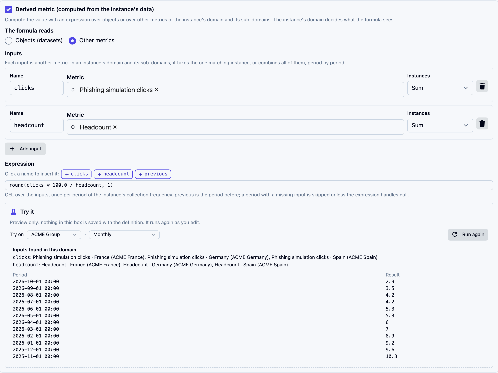
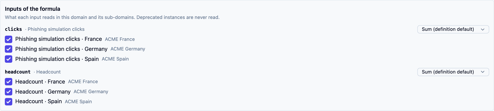

# Formulas on definitions

Most computed metrics are made from picked metrics with the [New computed metric](creating.md) window. A definition can also carry a formula of its own, which every instance of the definition runs in its own domain. Such formulas come from libraries, or from definitions written before computed metrics could start from instances.

They do two things picked metrics cannot:

- **combine every metric of a kind** in the domain and its sub-domains: the sum of the clicks of every site below a group, the worst remediation time across entities;
- **read objects** rather than metrics: the share of applied controls that are active, the average progress of the audits in a domain.

You edit them in two places: on the definition's edit form, or from any of its metrics with [Edit formula](editing.md#a-formula-that-is-its-definitions), which opens the same block in a drawer.


In this version, a new computed metric starts from metric instances. The formula block shows on a definition's form only when the definition already has a formula.


<figure><figcaption>
A group-level click rate: each input sums its metric across the group's domains
</figcaption></figure>

## The formula reads: Other metrics

Each **input** names another numeric metric definition and how its instances combine:

| Instances | The input's value for a period |
|---|---|
| **One value** | The single instance of that metric in the domain and its sub-domains. With none, or several, the metric shows an error |
| **Sum** | The values added up |
| **Average** | The average of the values |
| **Minimum**, **Maximum** | The lowest, the highest value |
| **Count** | How many instances have a value |

A combined input only counts the instances that have a value for the period; when none has one, the input is missing (see [Missing values](formulas.md#missing-values)).

The input's **Name** is what the expression uses. **Add input** adds one; the bin removes one.

Deprecated instances are never read, so replacing an instance with a new one does not count it twice.

### Choosing per instance

The definition sets how each input combines by default. On each instance's edit form, **Inputs of the formula** shows what every input reads in that instance's domain, and lets the instance decide otherwise.

<figure><figcaption>
What each input reads below ACME Group, and how it combines
</figcaption></figure>

- For a **One value** input in a domain that holds several instances, pick the one it reads.
- For a combined input, untick the instances it should leave out, such as a duplicate.
- Change how an input combines for this instance only. A click rate created at group level can sum the clicks reported per site but take the **Maximum** of a headcount that two sites both report.

A subsidiary added later is read without anyone ticking it.

## The formula reads: Objects (datasets)

A **dataset** reads one kind of object in the instance's domain and its sub-domains, keeps the rows its filters match, and answers the aggregates you list: count, distinct count, sum, average, minimum, maximum, median, percentile, standard deviation, optionally grouped by a field with a fixed set of values such as a status, a yes/no field or a related object.

- Name each dataset; the expression reads its aggregates by name, such as `active.count * 100.0 / controls.count`.
- Filter values accept `{{today}}`, `{{now}}` and offsets such as `{{today-30d}}`.
- The value is visible to everyone who may view the instance, so a dataset cannot group by a field holding free text, such as a name or a description.

The vocabulary is the one the workflow **Read objects** step uses in its "Numbers about the matches" mode; see the [action reference](../workflows/actions.md#numbers-about-the-matches).

Besides the datasets, the expression can read `previous` (the instance's latest result), `metrics.<ref_id>.value` (the latest value of another instance in the same scope, by its reference id), `now` and `today`.

A formula over objects computes on the instance's collection frequency from the current data: it has no history before the day the instance was created. Older than a week, one result per instance and per day is kept, so a long series does not grow by the hour.

A formula reads either objects or other metrics, not both. Switching **The formula reads** clears the other side. To combine them, make the dataset formula a metric of its own and use it as an input; its history starts on the day it was created.

## Try it

**Try it** runs the formula against a domain without saving anything, and runs again as you edit.

- **Try on** picks the domain, and for a formula over metrics, the frequency.
- **Inputs found in this domain** lists the instances each input reads. A domain holding several instances of a **One value** input's metric is flagged: choose one on the instance.
- The last periods follow, most recent first.

From a metric's **Edit formula** drawer, **Try it** starts on that metric's domain and frequency, and draws its current results beside the new ones.

## Who sees what

A formula reads the instance's domain and its sub-domains, never above or beside it, and with no user identity: its value is a fact about the domain, the same for everyone allowed to see the instance. To cover several domains, create the instance in their common parent.
