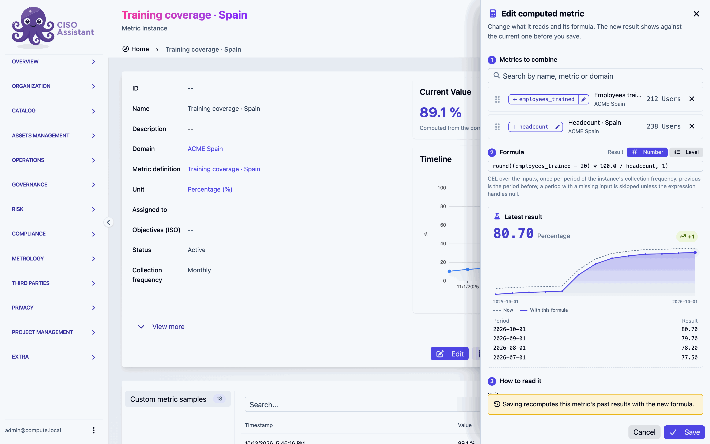

# Edit a formula

**Edit formula** opens a drawer on the right of the page. The metric stays in view while you work, and the drawer draws the results of your edit against the ones the metric holds now, before anything is saved.

<figure><figcaption>
The drawer sits beside the metric: nothing to leave, nothing to lose
</figcaption></figure>

The button is in two places:

- on the metric's page, next to **Refresh now**;
- on the metric's edit form, in the **Formula** card at the top.

## What the drawer shows

The drawer shows the steps of the [New computed metric](creating.md) window you already know, **Metrics to combine** and **Formula**, and a third, **How to read it**, holding the unit and **Higher is better**.

The metric's name, domain, collection frequency and target are not in the drawer: they stay on the metric's edit form, which is where you change them.

<figure><figcaption>
Dashed: what the metric holds now. Solid: what it would hold with this formula
</figcaption></figure>

### Compare before you save

The chart under **Latest result** draws two lines over the last 24 periods, on one scale:

- **Now**, dashed: the results the metric holds today;
- **With this formula**, solid: the results your edit would give.

Hover a point to read both values for that period. When the two lines meet, the edit does not change that period.

### What you can change

- **Swap a metric** for another one, for example the same indicator in another country: remove the row, search, pick. The formula keeps its names.
- **Add, remove, rename or reorder** metrics, as when creating.
- **Rewrite the formula**, or switch its result between **Number** and **Level**.
- **Change the unit or Higher is better.**

**Save** stays off until something changes.

### What a save does

- The metric's past results are recomputed with the new formula. The drawer says so above **Save**: "Saving recomputes this metric's past results with the new formula."
- The drawer closes. On the metric's page, the value and the chart update by themselves once the computation is done. On the edit form, you stay on the form, and it takes the change in: saving the form afterwards keeps your new formula.

### When other metrics share the definition

A definition can be shared, for example when the same indicator computed in two countries reuses one definition. Editing one metric never changes the others: the drawer warns "Other metrics use its definition (2): saving gives this metric a definition of its own and leaves them unchanged", and the confirmation reads "Saved: this metric now has a definition of its own".

A few edits are refused rather than surprise someone:

| Message | Why | What to do |
|---|---|---|
| "Other metrics read this one (…); its definition is shared, so its formula can only change once they no longer read it" | Giving this metric a new definition would change what those formulas read | Edit those formulas first, or create a new computed metric instead |
| "Other formulas read this metric as a number: its result type cannot change while they do" | A level cannot be read by a formula | Keep the result a number, or create a separate level metric that reads this one |
| "*Domain* does not hold every picked metric: pick metrics within it, or move this metric to a higher domain first." | The metric can only read metrics in its domain and below | Pick metrics within it, or change the metric's domain on its edit form first |

Making a copy of a shared definition needs the right to add metric definitions in the metric's domain.

### When a picked metric is gone

If a metric the formula read was deleted, or is no longer visible to you, its row is missing and the drawer says "Pick again the instances of: *name*". Pick a replacement under the same name, or rewrite the formula without it.

### A formula that comes with its definition

A metric whose formula comes with its definition, for example from a library, opens that formula in the drawer instead. Saving it changes every metric using the definition, and the drawer says how many before you save.

## Closing the drawer

- **✕**, **Cancel** or **Escape** close it. Escape first closes whatever list is open inside the drawer, such as the search results or the formula suggestions.
- With changes not saved, closing asks first:

<figure><figcaption>
Keep editing, or Discard the changes
</figcaption></figure>

- **Cmd+Enter** (macOS) or **Ctrl+Enter** saves from anywhere in the drawer, the formula field included.

On a phone, the drawer takes the full width of the screen.
