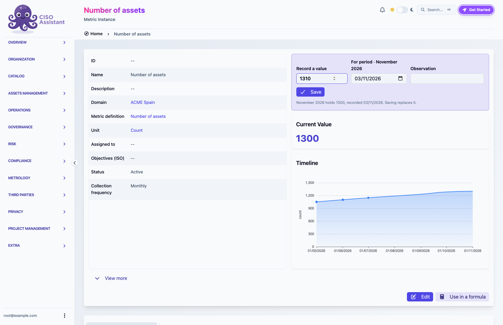

# Record a value

A metric's page carries a **Record a value** strip. Type the value, press **Enter** or click **Save**, and the metric's current value and timeline update in place. No window opens.

<figure><figcaption>
The strip sits at the top of the metric's page, above its current value and timeline
</figcaption></figure>

## The period

A metric with a collection frequency records values **for a period**: the calendar month for a monthly metric, the quarter, the ISO week, the day. The strip proposes the current period; pick any day inside another period to record for that one, for example last month's value entered on the 3rd.

The line under the fields says what the chosen period holds, with the value and the day it was recorded, or that it holds nothing yet. A second value for the same period **replaces** the first. Correcting a value is therefore the same gesture as entering it: pick the period, type the right value and save. Replacing takes the right to change samples; adding only the right to add them.

A metric without a collection frequency records a value for its moment only, as before, one per second.

Values recorded before periods existed keep their timestamp and are read by the period that timestamp falls in.

## Observation and evidence

**Observation** is a free note kept with the value. Evidence is attached from the metric's samples list, as before, through the metric's evidence.

## How values are shown

Everywhere a value is displayed, it is rounded to the definition's **Decimals**: the metric page, the lists, dashboard widgets and chart tooltips. The stored value keeps its precision, and formulas read it unrounded. Leave **Decimals** empty for the unit's default: one decimal for a percentage, none for a count, as entered for other units.

A computed metric has no strip: its values come from its formula. See [Computed metrics](README.md).
