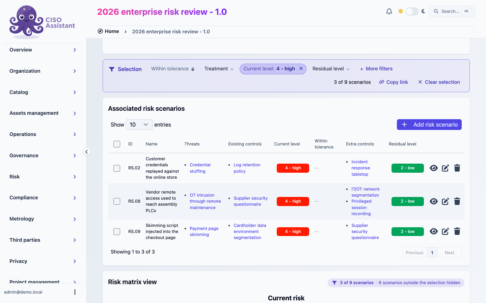
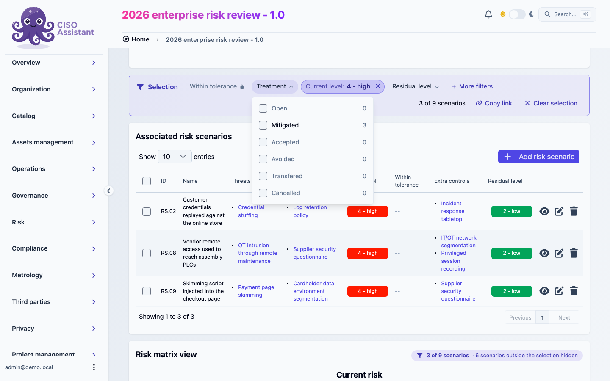
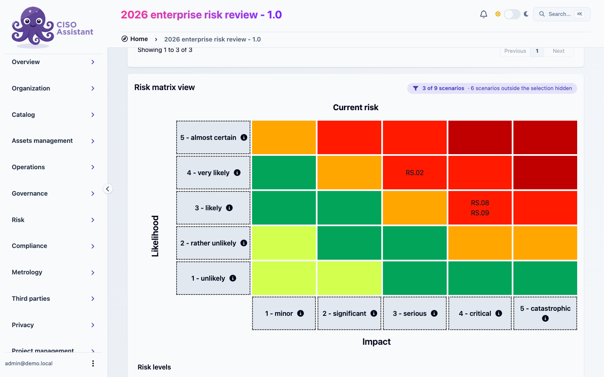
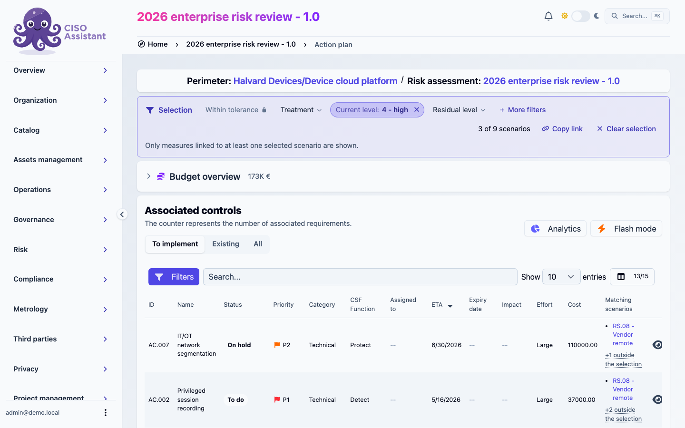
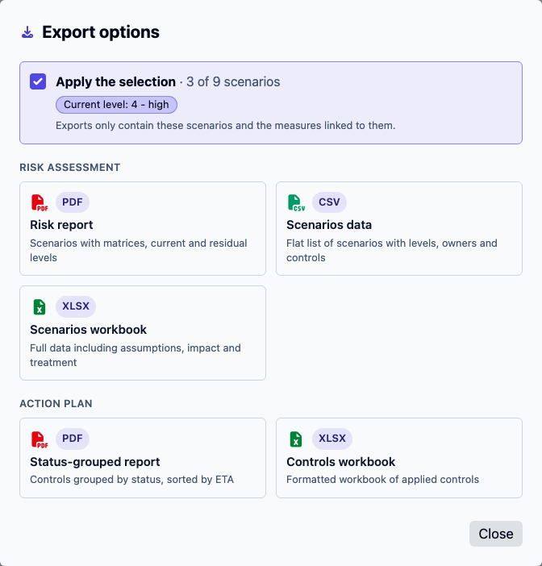

# Scenario selection

The **Selection** bar filters the risk scenarios of a [risk assessment](../concepts/risk-assessments.md). The scenarios it keeps are the ones every view of the assessment then works with: the scenario table, the risk matrices, the [action plan](action-plans.md) and the exports.

A typical use: select the scenarios that are not within tolerance, review them on the matrix, open the action plan to see the measures that treat them, and export a report limited to that set.

## Where to find it

Open a risk assessment. The **Selection** bar sits between the assessment details and **Associated risk scenarios**. It is the only place to filter the scenario table, which has no filters of its own.

The same bar is at the top of the assessment's action plan.

<figure><figcaption>
The Selection bar with <strong>Current level</strong> set to <em>4 - high</em>: 3 of 9 scenarios are kept, and <strong>Associated risk scenarios</strong> lists only those three
</figcaption></figure>

## Selecting scenarios

Click a filter, tick one or more values, and the page updates straight away. Values ticked in the same filter widen the selection (a scenario matching any of them is kept). Different filters narrow it (a scenario has to match all of them). **Within tolerance** is the exception: it takes one value, and ticking the other one replaces it.

| Filter | Keeps scenarios by |
|---|---|
| **Within tolerance** | Whether the current risk level is at or below the assessment's risk tolerance |
| **Treatment** | Treatment option |
| **Current level** | Current risk level, on the assessment's risk matrix |
| **Residual level** | Residual risk level |
| **Owners** | Scenario owner |
| **Threats** | Linked threat |
| **Assets** | Linked asset |
| **Qualifications** | Qualification |
| **Labels** | Label |

The first four are always on the bar. The others are under **More filters** and move onto the bar once they are in use. A filter with nothing to choose from in this assessment is left out: **Threats** does not appear if no scenario has a threat.

Each value comes with the number of scenarios it would keep, given the other filters already applied. A value that would keep none is greyed out.

<figure><figcaption>
The <strong>Treatment</strong> filter, open. Each value shows how many of the scenarios already selected it would keep
</figcaption></figure>

**Owners**, **Threats**, **Assets**, **Qualifications** and **Labels** can hold many values. Their list loads 25 values at a time, with **Load more** at the bottom, and gets a search box when there are more than 8.

An applied filter turns into a pill showing its values. The × on the pill removes the filter, and **Clear** inside an open filter unticks its values.

On the right of the bar:

- the counter, for example _3 of 9 scenarios_
- **Copy link**, which copies the address of the page with the selection in it
- **Clear selection**, which goes back to all scenarios

If nothing matches, the bar says **No scenario matches the selection**.


**Within tolerance** needs a risk tolerance on the assessment. Without one the filter shows a lock, and opening it gives a **Set the threshold** link to the assessment's edit page.


## What the selection changes

### On the risk assessment

- **Associated risk scenarios** lists the selected scenarios only.
- **Risk matrix view** places the selected scenarios only. A badge above the matrices gives the count and how many scenarios are hidden.
- The **Action plan** button carries a small badge with the number of selected scenarios, and opens the action plan with the same selection.
- **Export** offers to apply the selection (see [Exports](#exports)).

The assessment's **Analytics** and **Risk trajectory** pages do not follow the selection. They always cover every scenario.

<figure><figcaption>
<strong>Risk matrix view</strong> with the selection applied: the three selected scenarios on the <strong>Current risk</strong> matrix, and the badge counting the six that are hidden
</figcaption></figure>

### On the action plan

The action plan keeps the measures linked to at least one selected scenario. The bar is there too, so the selection can be changed without going back.

The switch above the table decides which links count:

| Switch | Shows |
|---|---|
| **To implement** | Extra controls of the selected scenarios. This is the default. |
| **Existing** | Their existing controls |
| **All** | Both |

The **Matching scenarios** column lists the selected scenarios each measure is linked to. When a measure also treats scenarios outside the selection, the column adds _+n outside the selection_; hover it to see which ones.

The budget overview, **Analytics** and **Flash mode** follow the selection and the switch.

<figure><figcaption>
The action plan of the same assessment, on the same selection. <strong>Matching scenarios</strong> names the selected scenarios each measure is linked to
</figcaption></figure>

### Exports

With a selection applied, the **Export** dialog of the risk assessment shows **Apply the selection**, ticked, with the count and the filters in use. Leave it ticked and the exports contain the selected scenarios and the measures linked to them. Untick it to export the whole assessment.

<figure><figcaption>
<strong>Export options</strong> with <strong>Apply the selection</strong> ticked
</figcaption></figure>

| Export | Format | With the selection applied |
|---|---|---|
| **Risk report** | PDF | Selected scenarios only. A **Scenario selection** box lists the filters, and every page footer carries the count. |
| **Scenarios data** | CSV | Selected scenarios only. The file name carries `selection`. |
| **Scenarios workbook** | Excel | Selected scenarios only, plus a **Selection** sheet with the count and the filters |
| **Status-grouped report** | PDF | Measures of the selected scenarios, with the same box and footer |
| **Controls workbook** | Excel | Measures of the selected scenarios, plus the **Selection** sheet |

The two action plan exports contain the measures **To implement**, the default of the action plan page.

A report built from a selection always says so, so a partial export cannot be mistaken for the full register.

## Sharing and coming back

The selection is part of the page address. **Copy link** gives a link that opens the assessment, or its action plan, on the same selection for anyone who can see the assessment.

Your browser also remembers the last selection of each assessment. Opening the assessment again restores it, with the message **Selection restored from your last visit.** and a **Start from all scenarios** button. A link that carries its own selection takes precedence over the remembered one.

If a selection refers to something that has since been deleted, a threat for instance, that filter is ignored and shown as a warning pill you can dismiss.

## Related

- [Risk assessments](../concepts/risk-assessments.md)
- [Action plans](action-plans.md)
- [Risk trajectory](risk-trajectory.md)
- [Working with tables](working-with-tables.md)
