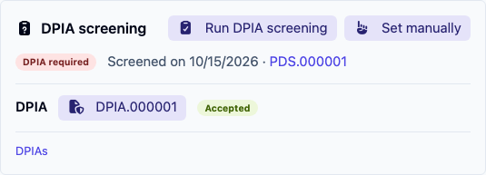
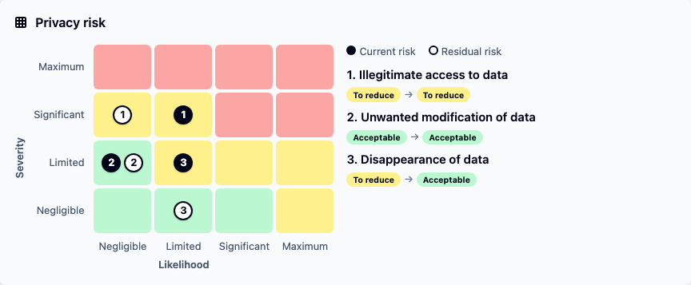
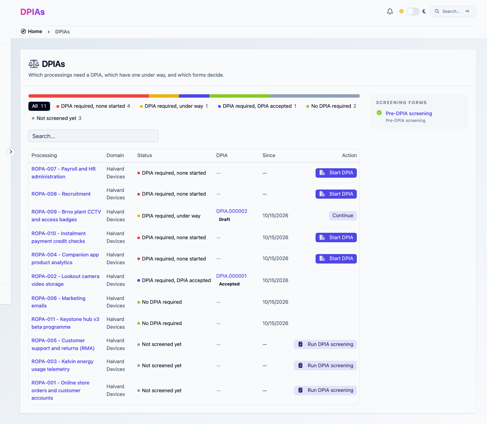

# Screening processings and running DPIAs

This guide takes a processing from _Not screened yet_ to an accepted DPIA:

1. a **screening** decides whether the processing needs a DPIA;
2. the **DPIA** assesses the risks to the people whose data it handles;
3. accepting the DPIA records it on the processing, along with the measures it picked.

You need an administrator to turn the feature on and load the forms. After that, anyone who can edit a processing can screen it and start its DPIA. A reviewer, typically the DPO, accepts each one. For the reasoning behind each step, see [DPIA and screening](../concepts/dpia.md).

## 1. Turn on DPIAs

Go to **Settings → Feature flags** and, under **GDPR / Privacy**, turn on **DPIAs**. This also turns on **Forms and Requests**, which screenings and DPIAs run on.

**DPIAs** then appears under **Privacy** in the sidebar.

## 2. Load the forms

Go to **Libraries** and load the two forms that ship with the platform:

| Library | What it is |
|---|---|
| **Pre-DPIA screening** | The nine WP29/EDPB criteria, as the CNIL applies them. Two or more criteria met means a DPIA is required |
| **Data protection impact assessment (DPIA)** | A DPIA following the CNIL PIA method: context, core principles, risks, validation |

Both are available in English and French.

## 3. Set each processing's role

Screenings and DPIAs only apply to processings you are the controller of. Open **Privacy → Processings** and check the **GDPR role** column: _Controller_, _Joint Controller_ or _Data Processor_. **Controller register** at the top of the list shows the processings that can be screened.

A processing you carry out for a client belongs in the **Processor register**: its DPIA is the client's. See [Controller and processor registers](../concepts/privacy-register.md#controller-and-processor-registers).

## 4. Screen a processing

1. Open a controller processing. Its **DPIA screening** card shows _Not screened yet_.
2. Click **Run DPIA screening**. When several screening forms are loaded, pick one from the list. You can also right-click a processing in the list and choose **Run DPIA screening**.
3. A response opens with the processing filled in and locked. Answer the three pages:
   * **Processing identification**: your role, the stage and the planned start date.
   * **WP29 criteria**: tick the criteria that apply and justify them briefly. If the decision rests on a document, such as an email from the DPO, attach it under **Supporting document**.
   * **Exemptions**: only shown when two or more criteria are ticked.
4. As you answer, the response shows the outcome reached: **DPIA required**, **DPIA recommended**, **No DPIA required**, or **Exemption claimed — no DPIA required**.
5. Click **Submit**. The hint next to the button says what happens next:
   * **Submitting applies the result directly, no review needed.** You could set the verdict yourself, so it is written at once and the screening closes as accepted.
   * **Submitting sends it to a reviewer before anything is changed.** In every other case, or when the form was published with **Always require review**.


One criterion gives **DPIA recommended**. The form errs on the safe side and records that a DPIA is required, with a **Recommended** badge on the card. If the DPO decides otherwise, set the verdict by hand (step 6).


## 5. Review the screening

A reviewer opens the screening from **Requests**, or from **Review** on the DPIAs page. The response shows **On accept, this will write** and the verdict. The reviewer can:

* **Accept** it as is.
* **Override** the verdict. A **Justification (required)** is kept with it, and the card then shows _Adjusted at acceptance on_ the date.
* **Request changes** or **Reject** it, like any [request](../concepts/quick-forms.md#lifecycle).

With the shipped form, a claimed exemption gives **No DPIA required**: the reviewer checks the exemption's reference before accepting. A form of your own can leave such outcomes to the reviewer instead (see [Screening](../concepts/dpia.md#screening)).

Once accepted, the card shows **DPIA required** or **No DPIA required**, _Screened on_ the date, and a link to the screening.

<figure><figcaption>
The DPIA screening card: the verdict, where it comes from, and the DPIA
</figcaption></figure>

## 6. Set the verdict by hand

A DPO can decide without a screening, or against it. Click **Set manually** on the **DPIA screening** card, choose **DPIA required** or **No DPIA required**, and optionally give a **Reason for the change**. **Set manually** is also in the right-click menu of the processings list.

Every change, from a screening, an override or a manual decision, is kept in the processing's **DPIA requirement history** tab.

## 7. Carry out the DPIA

1. When the processing requires a DPIA, the card offers **Start DPIA**. The DPIAs page offers it too, on every processing in _DPIA required, none started_.
2. A DPIA opens with the processing filled in. Some pages show what the processing already records, such as its personal data or its purposes, so the questions only ask what the register does not hold.
3. On each of the three risk pages, **Risks: illegitimate access to data**, **Risks: unwanted modification of data** and **Risks: disappearance of data**:
   * describe the impacts, the threats and the risk sources;
   * pick the applied controls that treat the risk;
   * rate **Severity** and **Likelihood**, and justify each;
   * optionally, rate them again once the planned measures are implemented.
4. The **Privacy risk** rating places each risk on its grid: _Acceptable_, _To reduce_ or _Unacceptable_, for the current risk and for the residual one. **Results**, the form's last tab, shows them all on one grid.

   <figure><figcaption>
The Privacy risk grid on a DPIA's Results: each risk's Current risk and Residual risk
</figcaption></figure>

5. Fill in **Validation**: the DPO's opinion, the data subjects' views, and the **Decision**.
6. Submit it. A DPIA goes to a reviewer like a screening does.


If a residual risk stays _Unacceptable_, the DPIA shows **Residual risk unacceptable: consult the supervisory authority**. Article 36 GDPR requires you to consult it before the processing starts.


## 8. Accept the DPIA

Before deciding, the reviewer sees what accepting writes onto the processing:

* **DPIA**: this response becomes the processing's DPIA.
* **Associated controls**: the measures the DPIA picked, added to the processing's own.

Once accepted, the card links to the DPIA with its _Accepted_ status, and the processing moves to _DPIA required, DPIA accepted_. A rejected DPIA does not count: the card offers **Start DPIA** again.

## 9. Follow the register

**Privacy → DPIAs** shows every controller processing you can see by state, with the next step on each row. Start with _DPIA required, none started_: when it is empty, the page says **Every processing that needs a DPIA has one under way.**

<figure><figcaption>
Every controller processing by state, with its next step
</figcaption></figure>

## Adapt the forms

The two forms are library content, so you can copy them in the library builder and change them:

* **Your criteria are different**, for example your supervisory authority's mandatory list. Edit the screening's questions and outcomes, then map each outcome to a verdict in its **On accept** setting. Any form whose **On accept** writes **DPIA required** shows on the DPIAs page under **Screening forms**.
* **Your risk method is different.** Change the **Severity** and **Likelihood** scales, or repaint the **Privacy risk** grid. See [Scales and ratings](../concepts/quick-forms.md#scales-and-ratings).
