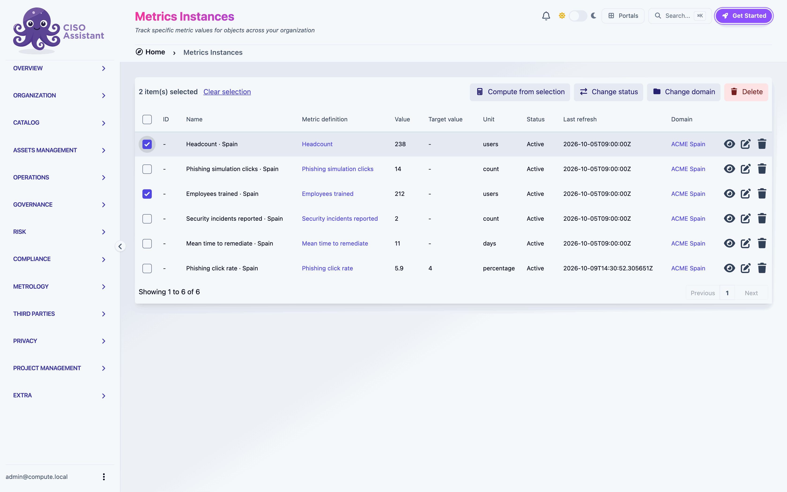
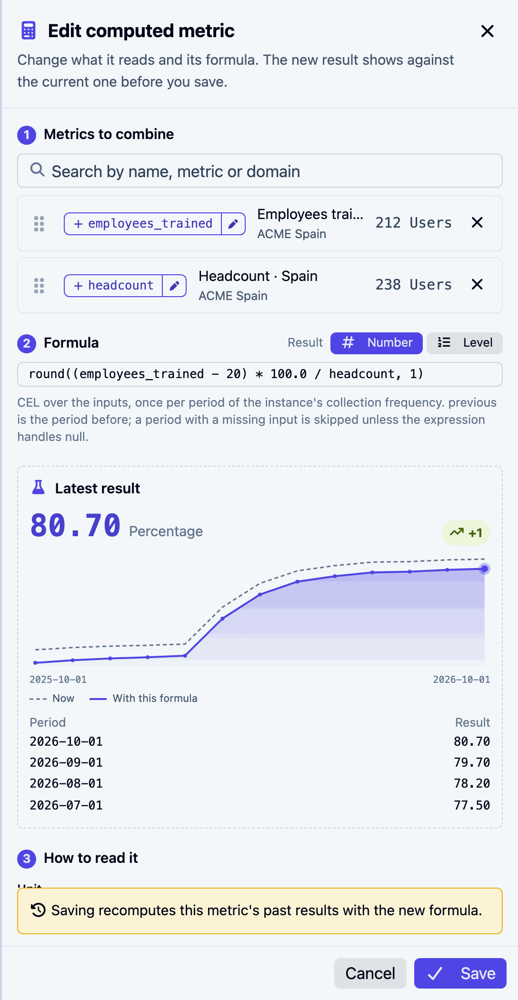

# Creating your first computed metric

This walkthrough takes about ten minutes. You will combine two metrics you already track into a training coverage rate, check its history before saving, read the result, try a change to its formula, and turn the rate into a status level.

You need two numeric metric instances with a few samples, in the same domain or under a common parent. The example uses *Employees trained · Spain* and *Headcount · Spain*, both monthly, in the *ACME Spain* domain. You also need the right to create metric instances and metric definitions in that domain.

## 1. Select the two metrics

1. Open **Metrology > Metric instances**.
2. Tick *Employees trained · Spain* first, then *Headcount · Spain*. The order matters: the first metric will be divided by the second.
3. In the bar that appears above the list, click **Compute from selection**.

<figure><figcaption>
Tick the metrics, then Compute from selection
</figcaption></figure>

The **New computed metric** window opens with both metrics under **Metrics to combine**, in the order you ticked them. Each one has a name the formula can use: `employees_trained` and `headcount`.

## 2. Write the formula

1. Under **Formula**, next to **Start from:**, click **Ratio (%)**. The formula becomes `employees_trained * 100.0 / headcount`.
2. Round it to one decimal: change it to `round(employees_trained * 100.0 / headcount, 1)`.

The **Latest result** box on the right computes it as you type: the current rate, how it moved since last month, a chart of the last twelve months and the last four values. Check them against what you expect before going further. Nothing is saved yet.

<figure><figcaption>
The result, with its history, before anything is saved
</figcaption></figure>

## 3. Name it and create it

1. **Name**: *Training coverage · Spain*.
2. **Domain** is already *ACME Spain*: the lowest domain holding both metrics. **Collection frequency** is already **Monthly**, taken from the metrics you picked.
3. **Unit**: **Percentage**. **Target value**: `90`. Leave **Higher is better** ticked.
4. Click **Create metric**.

The new metric's page opens. Within a few seconds its whole history is computed, one value per month since the first sample of its inputs, and the page fills in by itself.

<figure><figcaption>
1 current value, 2 timeline, 3 Use in a formula, 4 Edit formula, 5 Refresh now
</figcaption></figure>

A metric definition named *Training coverage · Spain* was created along with it. Nobody needs to enter samples: the metric recomputes every month, and on demand with **Refresh now**.

## 4. Try a change, safely

Suppose the 20 trainers in the headcount should not count as trained.

1. Click **Edit formula**. A drawer opens beside the page.
2. Change the formula to `round((employees_trained - 20) * 100.0 / headcount, 1)`.
3. Look at the chart under **Latest result**: the dashed line is what the metric holds now, the solid line what it would hold with your formula.

<figure><figcaption>
Every past month, before and after
</figcaption></figure>

Saving would recompute every past month with the new formula, as the note above **Save** says. To keep the metric as it is, click **Cancel**, then **Discard**. To keep the change, click **Save**: the drawer closes and the page updates once the computation is done.

## 5. Turn the rate into a status

A level reads better on a dashboard than a percentage: *On track* or *Behind*.

1. On *Training coverage · Spain*, click **Use in a formula**. The window opens with the metric already picked and its name, `training_coverage_spain`, in the formula.
2. Next to **Result**, choose **Level**.
3. Write `training_coverage_spain < 90.0 ? "Behind" : "On track"`. The **Levels** box fills with *Behind*, then *On track*, in the order the texts appear.
4. Check the order: worst first, best last. With **Higher is better** ticked, the last level is the best, so moving up to *On track* shows as good news. Drag a level to change the order.
5. Name it *Training status · Spain* and click **Create metric**.

The status recomputes whenever the coverage does. Both metrics can go on a [dashboard](../features/dashboards.md).

## Next steps

- [Create a computed metric](../features/metrics/creating.md): every option of the window.
- [Edit a formula](../features/metrics/editing.md): what a save changes when other metrics share a definition.
- [Formula reference](../features/metrics/formulas.md): missing values, `previous`, functions and levels.
