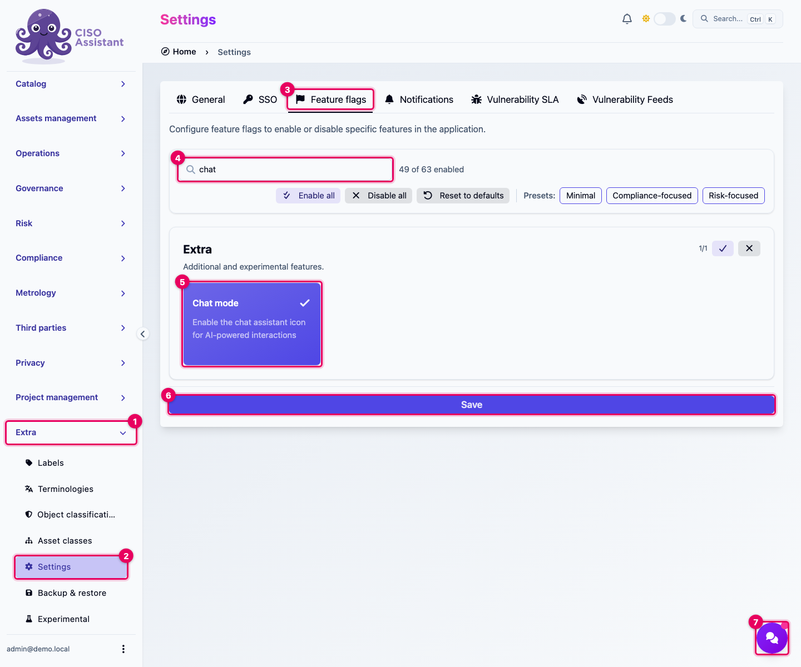
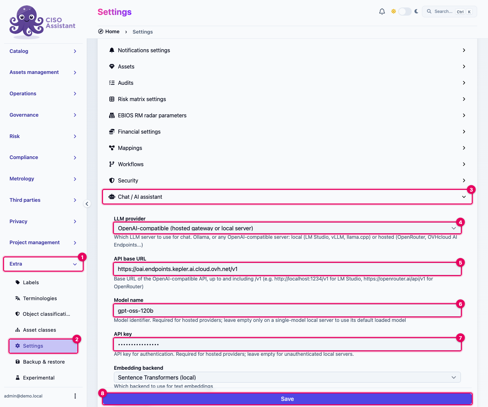

# Setting up the AI assistant

Compatible with: SaaS or on-premises, CE or Pro

The chat assistant answers questions about your data and frameworks. It needs three things, in this order: the instance must allow it, the feature must be switched on, and the assistant must be pointed at a model server. You need administrator rights for the last two steps.



### Allow the assistant on the instance

**On SaaS**, environment variables are managed by intuitem and cannot be set from your instance. Open a ticket on the [customer support portal](https://intuitem.atlassian.net/servicedesk/customer/portal/4) asking to enable the AI assistant, then go to the next step once it is done.

**On-premises**, start the backend **and** the Huey worker with `ENABLE_CHAT=True`. In Docker Compose, add it to the `environment` section of both services, then run `docker compose up -d`:

```yaml
services:
  backend:
    environment:
      - ENABLE_CHAT=True
  huey:
    environment:
      - ENABLE_CHAT=True
```

On Helm, set `enabled: true` under the chat values and enable Qdrant; see [Helm chart](../installation/helm-chart.md#ai-assistant-chat-rag).

The assistant also needs a reachable Qdrant instance (`QDRANT_URL`), which it uses to search your data. The Docker Compose files already ship one.



### Turn on the feature flag

1. In the sidebar, open **Extra**.
2. Click **Settings**.
3. Open the **Feature flags** tab.
4. Type `chat` in the search box.
5. Select **Chat mode** so it shows a check mark.
6. Click **Save**.
7. The chat icon appears at the bottom right of every page.

<figure><figcaption><p>The <strong>Feature flags</strong> tab, filtered on <code>chat</code>, with <strong>Chat mode</strong> saved: the chat icon now shows at the bottom right.</p></figcaption></figure>

If **Chat mode** is not in the list, the previous step is missing. See [Feature flags](../configuration/settings/feature-flags.md).



### Connect a model

For a hosted provider (OVHcloud AI Endpoints, OpenRouter...) or a local server such as LM Studio, vLLM or llama.cpp:

1. In the sidebar, open **Extra**.
2. Click **Settings**, and stay on the **General** tab.
3. Open the **Chat / AI assistant** section.
4. Set **LLM provider** to `OpenAI-compatible (hosted gateway or local server)`.
5. Enter the **API base URL**, ending at `/v1` and no further, for example `https://oai.endpoints.kepler.ai.cloud.ovh.net/v1`.
6. Enter the **Model name**, the exact identifier from the provider's catalogue. Required for hosted providers.
7. Enter the **API key**. Required for hosted providers; leave it empty for a local server without authentication.
8. Click **Save**.

<figure><figcaption><p>The <strong>Chat / AI assistant</strong> section filled in for OVHcloud AI Endpoints with the <code>gpt-oss-120b</code> model.</p></figcaption></figure>

For an Ollama server, set **LLM provider** to `Ollama` instead, then fill in the **Ollama URL** (for example `http://host.docker.internal:11434`) and the **LLM model**, and click **Save**.

Saving does not contact the model server: a wrong URL, key or model name shows up on the first question. For each provider's values, see [Hosted AI providers](ai-providers.md) and [Paul, the EBIOS RM model](paul.md).


**A model on your own network** (`localhost`, a LAN address, an in-cluster service) is refused until the backend and Huey worker are started with `ALLOW_PRIVATE_NETWORK_REQUESTS=True`. See [Reaching services on a private network](../installation/private-network-requests.md). On SaaS, the model must have a public HTTPS address.




### Check it works

Click the chat icon and ask a question that reads your data, such as *how many applied controls do we have?* A reply that starts with `[No LLM configured — showing retrieved context]` means the assistant found your data but could not reach the model: see [Checking it works](ai-providers.md#checking-it-works) for the causes, in order.



## Related pages

* [Hosted AI providers](ai-providers.md): OVHcloud AI Endpoints, OpenRouter, what data leaves your infrastructure, cost.
* [Paul, the EBIOS RM model](paul.md): running intuitem's EBIOS RM model.
* [Reaching services on a private network](../installation/private-network-requests.md)
