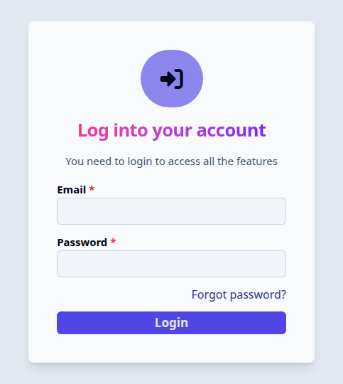
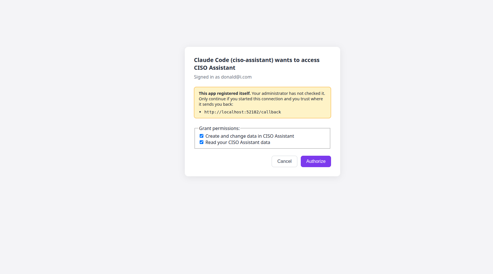
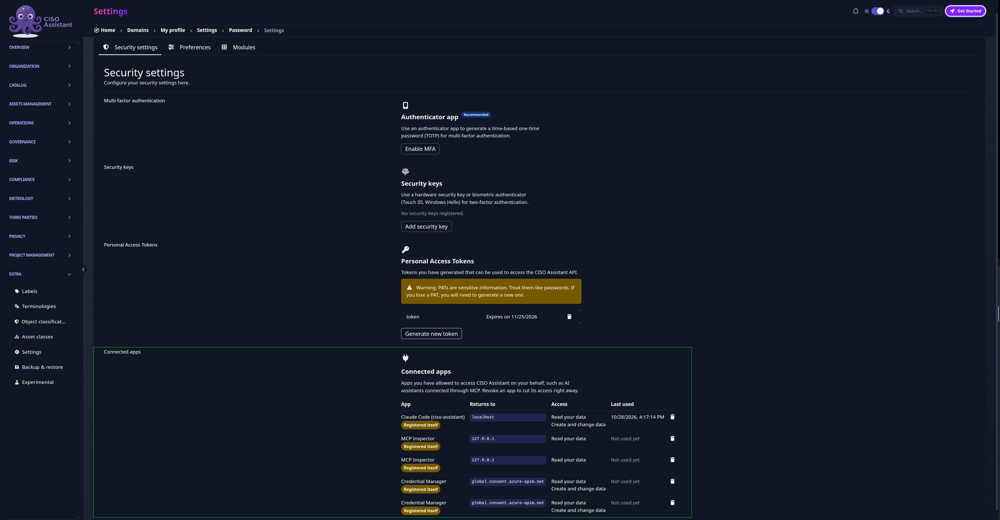
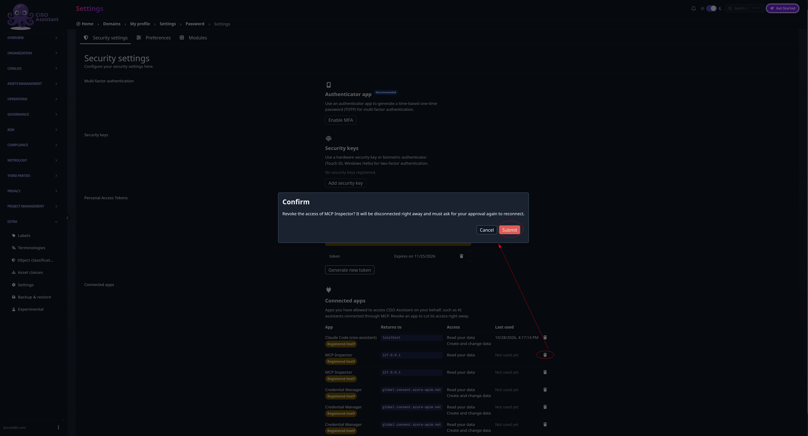

# MCP sign-in with OAuth

Compatible with: SaaS or on-premises, CE or Pro

Tested MCP clients: Microsoft Copilot Studio, Claude Code, MCP Inspector

With OAuth sign-in, a user adds the CISO Assistant MCP URL to their AI assistant
and signs in with their normal CISO Assistant account. They don't need to create
or paste a Personal Access Token (PAT).

- **Each user approves the app themselves**, on a consent page in CISO Assistant.
- **The app gets that user's permissions.** It sees the same domains and objects
  as the user in the UI, no more.
- **The user picks read or write access** when they approve.
- **The user can revoke the app at any time** from their profile settings.

This page covers the OAuth setup. For the MCP server itself, the tools and the
stdio setup, see the [MCP setup guide](mcp.md).

### How it works

1. The user gives the MCP URL to their client: the instance URL followed by
   `/mcp`, for example `https://<your-instance>/mcp`.
2. The client calls the URL without a token. The server answers `401` and tells
   the client where to sign in.
3. The client registers itself with CISO Assistant. This step is called Dynamic
   Client Registration (DCR).
4. A browser opens on the CISO Assistant login page. The user signs in as usual,
   including MFA or SSO.
5. CISO Assistant shows a consent page. The user picks the access and clicks
   **Authorize**.
6. The client gets a token and uses it for every MCP call, until the user
   revokes it.

<figure><figcaption><p>Step 4: the usual CISO Assistant login page. A user who is already signed in skips it</p></figcaption></figure>

<figure><figcaption><p>Step 5: the consent page for Claude Code. The yellow box warns that the app registered itself and shows where it sends the user back</p></figcaption></figure>

The MCP server runs as its own service, `backend-mcp`, next to the backend. It
shares the backend's database and checks each token there. Tool calls run inside
CISO Assistant as the signed-in user, with the same permission checks as the UI.

### Access levels

The consent page offers two levels:

| Scope       | Shown as                                 | What the app can do                         |
| ----------- | ---------------------------------------- | ------------------------------------------- |
| `mcp:read`  | Read your CISO Assistant data            | Use the read tools: list, get, count        |
| `mcp:write` | Create and change data in CISO Assistant | Use the tools that create, change or delete |

Write access never adds permissions. A user who can't edit a folder in the UI
can't edit it through MCP either.

If the server runs read-only (`CA_MCP_READ_ONLY=true`), only `mcp:read` is
offered and the write tools are hidden.

### Enable it (administrators)




#### Start the MCP service

The service is off by default. Start it with the `mcp` profile:

```bash
docker compose --profile mcp up -d
```

The proxy sends these paths to `backend-mcp`, so it is served on your existing
certificate:

- `/mcp`
- `/.well-known/oauth-protected-resource/mcp`
- `/.well-known/oauth-authorization-server/api`

If you run your own reverse proxy, add these three routes. Everything else stays
as before.




#### Set the public URL

`CISO_ASSISTANT_URL` must be the URL users and AI clients use to reach CISO
Assistant, for example `https://grc.example.com`. Set the same value on the
backend and on `backend-mcp`.

The login redirects, the token issuer and the MCP resource are all built from
it. A wrong value makes sign-in fail.




#### Turn on self-registration

Clients like Copilot Studio and Claude Code register themselves. This is off by
default. Turn it on, on the backend **and** on `backend-mcp`:

```env
OAUTH_DCR_ENABLED=true
```

To accept only some clients, list the hosts they may send users back to after
sign-in:

```env
OAUTH_DCR_ALLOWED_REDIRECT_HOSTS=global.consent.azure-apim.net,localhost
```

`global.consent.azure-apim.net` is Copilot Studio. `localhost` covers Claude
Code and other clients that run on the user's machine. Leave the variable empty
to accept any host. Redirects must use HTTPS, except for loopback addresses.




#### Choose read-only or read and write

`backend-mcp` is read-only by default. To let users grant write access:

```env
CA_MCP_READ_ONLY=false
```

Users who connected before the change keep their read-only access. They must
reconnect to be offered write access.




#### Check the setup

Each of these must return `200`:

```bash
H=grc.example.com
for p in /.well-known/oauth-protected-resource/mcp \
         /.well-known/oauth-authorization-server/api \
         /api/.well-known/openid-configuration; do
  curl -s -o /dev/null -w "%{http_code} $p\n" "https://$H$p"
done
```

`/mcp` without a token must return `401`.




**Apps that register themselves are not checked by anyone.** The consent page
says so, and shows where the app will send the user back. They can only reach
`/mcp`. Their tokens are refused on the REST API (`/api`).


### Connect a client

#### Microsoft Copilot Studio

1. On your agent, go to **Tools** > **Add a tool** > **New tool** > **Model
   Context Protocol**.
2. Enter the server name, a precise description, and the URL ending in `/mcp`.
3. For authentication, choose **OAuth 2.0**, type **Dynamic discovery**.
4. Create the connection. A browser window opens on CISO Assistant. Sign in,
   then click **Authorize**.

The app shows up as **Credential Manager** on the consent page and in
**Connected apps**. That's the name Copilot Studio registers with.

Copilot Studio runs in Microsoft's cloud, so it must reach your instance over
HTTPS from the internet. See [Making it reachable](mcp.md#making-it-reachable).

#### Claude Code

```bash
claude mcp add --transport http ciso-assistant https://<your-instance>/mcp
```

Then run `/mcp` in Claude Code, pick **ciso-assistant** and choose
**Authenticate**. A browser opens on the CISO Assistant login page.

#### Other clients

Any MCP client that supports OAuth works the same way: give it the URL ending
in `/mcp` and no token. To test the setup without an AI client, use the
[MCP Inspector](https://github.com/modelcontextprotocol/inspector):

```bash
npx @modelcontextprotocol/inspector
```

Set the transport to **Streamable HTTP**, enter the URL, and use **Open Auth
Settings** > **Quick OAuth Flow**.

### Manage connected apps (users)

Go to your profile icon > **Settings** > **Security settings** > **Connected apps**. The table lists
every app that can access your account:

| Column     | Meaning                                                              |
| ---------- | -------------------------------------------------------------------- |
| App        | The name the app gave. **Registered itself** means nobody checked it |
| Returns to | Where the app sends you back after sign-in. This identifies the app  |
| Access     | **Read your data**, and **Create and change data** if granted        |
| Last used  | The last call the app made. Updated at most once a minute            |

<figure><figcaption><p>Connected apps in the security settings: Claude Code with read and write access, and apps that are authorized but not used yet</p></figcaption></figure>

To cut an app's access, click the trash icon on its row, then **Submit**. It
stops working right away. To connect again, it must ask for your approval
again.

<figure><figcaption><p>Revoking MCP Inspector asks for confirmation first</p></figcaption></figure>


An app that says it has no access, or only read access, will not fix itself.
Revoke it, or clear its sign-in in the client (in Claude Code: `/mcp` > **Clear
authentication**), then connect again and grant the access you want.


### Personal Access Tokens still work

`backend-mcp` also accepts a PAT, sent as `Authorization: Bearer <PAT>`. Existing
setups that use **API key** authentication keep working. A PAT gets read and
write access, within the user's permissions.

### Troubleshooting

#### The client says the server has no registration endpoint

`OAUTH_DCR_ENABLED` is not `true` on both the backend and `backend-mcp`. Set it
on both and recreate the two services.

#### Sign-in loops back to the login page, or fails with a redirect error

`CISO_ASSISTANT_URL` does not match the URL in the browser. Use the same URL for
the instance, the client and the setting.

#### Registration fails with "Redirect host is not allowed"

The client's callback host is not in `OAUTH_DCR_ALLOWED_REDIRECT_HOSTS`. Add it,
or leave the variable empty.

#### The write tools say they need the `mcp:write` scope

The app was granted read access only. Check that `CA_MCP_READ_ONLY=false`, then
reconnect and grant write access on the consent page.

#### `/api` answers "This client can only access the MCP endpoint."

This is expected. Tokens of apps that registered themselves only work on `/mcp`.
For REST API access, use a [PAT](pat.md) or a [service account](service-accounts.md).

#### `421 Misdirected Request`

The `Host` header is not in `CA_MCP_ALLOWED_HOSTS`. See
[Making it reachable](mcp.md#making-it-reachable).

#### `502 Bad Gateway` on the login page, behind a tunnel or a second proxy

Some proxies reject large response headers. The CISO Assistant frontend sends a
large `Link` header (page preload hints). Raise the proxy's header buffer size,
or remove the `Link` header at your proxy. It's only a speed hint.

### Environment variables

| Variable                           | Service              | Default                      | Description                                                                     |
| ---------------------------------- | -------------------- | ---------------------------- | ------------------------------------------------------------------------------- |
| `CISO_ASSISTANT_URL`               | backend, backend-mcp | -                            | Public URL of the instance. Must be the same on both services                   |
| `OAUTH_DCR_ENABLED`                | backend, backend-mcp | `false`                      | Let MCP clients register themselves                                             |
| `OAUTH_DCR_ALLOWED_REDIRECT_HOSTS` | backend              | -                            | Comma-separated hosts a self-registered client may redirect to. Empty means any |
| `CA_MCP_READ_ONLY`                 | backend-mcp          | `true`                       | Hide the write tools and offer only `mcp:read`                                  |
| `CA_MCP_ALLOWED_HOSTS`             | backend-mcp          | host of `CISO_ASSISTANT_URL` | Accepted `Host` headers, port included                                          |
