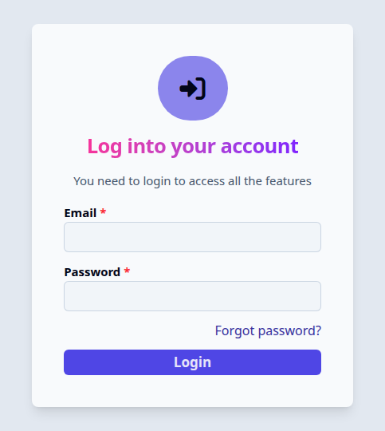
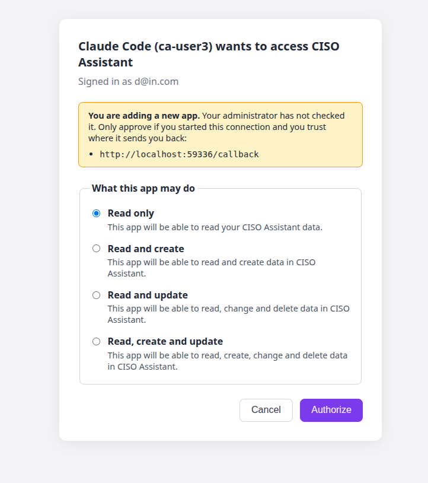
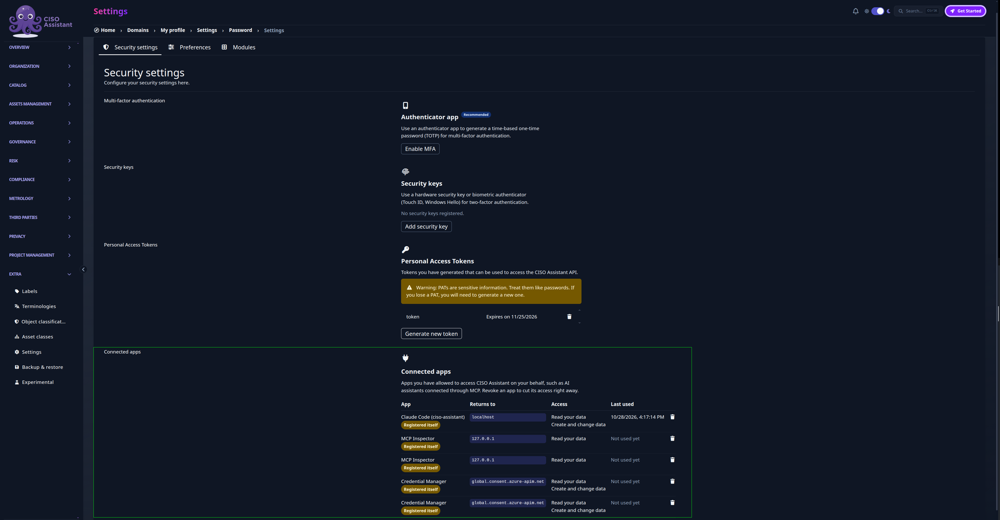
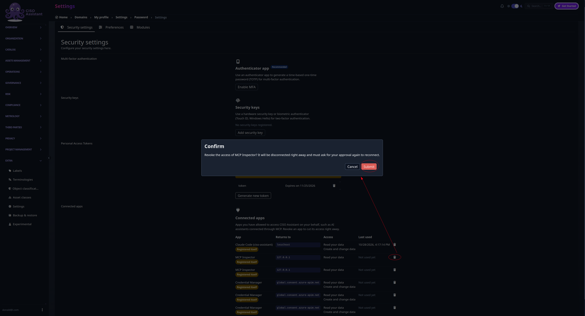
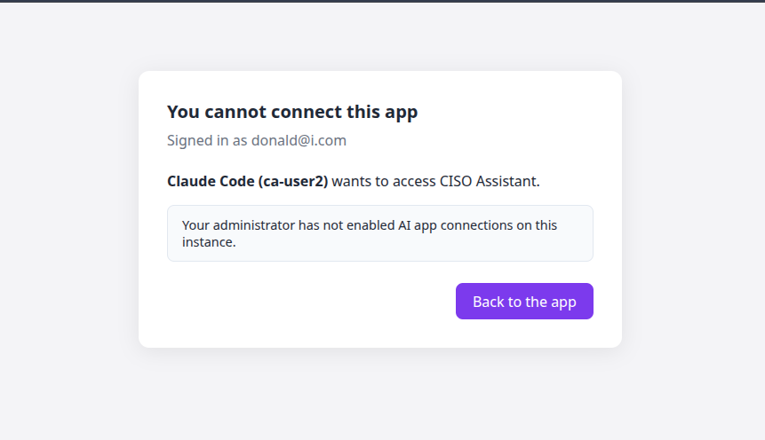

# MCP sign-in with OAuth

Compatible with: SaaS or on-premises, CE or Pro

Tested MCP clients: Microsoft Copilot Studio, Claude Code, MCP Inspector

With OAuth sign-in, a user adds the CISO Assistant MCP URL to their AI assistant
and signs in with their normal CISO Assistant account. They don't need to create
or paste a Personal Access Token (PAT).

- **Each user approves the app themselves**, on a consent page in CISO Assistant.
- **The app gets that user's permissions.** It sees the same domains and objects
  as the user in the UI, no more.
- **The app can get less than the user.** When they approve, the user chooses
  what the app may do: read only, or also create, update or delete.
- **The user can revoke the app at any time** from their profile settings.

This page covers the OAuth setup. For the MCP server itself, the tools and the
stdio setup, see the [MCP setup guide](mcp.md).

### How it works

1. The user gives the MCP URL to their client: the instance URL followed by
   `/mcp`, for example `https://<your-instance>/mcp`.
2. The client calls the URL without a token. The server answers `401` and tells
   the client where to sign in.
3. The client registers itself with CISO Assistant. This step is called Dynamic
   Client Registration (DCR).
4. A browser opens on the CISO Assistant login page. The user signs in as usual,
   including MFA or SSO.
5. CISO Assistant shows a consent page. The user chooses what the app may do
   and clicks **Authorize**.
6. The client gets a token and uses it for every MCP call, until the user
   revokes it.

<figure><figcaption><p>Step 4: the usual CISO Assistant login page. A user who is already signed in skips it</p></figcaption></figure>

<figure><figcaption><p>Step 5: the consent page for Claude Code. The yellow box warns that the user is adding a new app nobody checked, and shows where it sends the user back. Read is always on; Create, Update and Delete appear once an administrator allows apps to change data</p></figcaption></figure>

The MCP server runs as its own service, `mcp`, next to the backend. It has no
access to the database and holds no secret. For each tool call, it calls the
backend API with the app's own token. On every call, the backend checks the
token, the user's permissions and what the user allowed the app to do, as for
the UI. An app's token only works for the operations the MCP tools use, whether
it goes through `/mcp` or calls `/api` directly.

### Profiles

A profile says what an app may do once connected. An app can always read. On
top of that, the user may allow it to **create**, **update** and **delete**
data, in any combination. Each combination is a built-in profile, from
**Read only** to **Read, create, update and delete**.

- On the consent page, the user ticks what the app may do on top of reading.
  Nothing is ticked by default, which gives **Read only**.
- Create, Update and Delete are offered only when an administrator turned on
  **AI apps may change data (MCP)**. While it is off, every app is read only,
  whatever its profile, and gets its profile back when the flag is turned on.
- A profile only removes access. A user who can't edit a folder in the UI can't
  edit it through MCP either, whatever the profile.
- Apps that skip the consent page get **Read**.
- The app only sees the tools its profile allows. It can call `get_my_access`
  to learn what it may do. The backend refuses the rest anyway.
- To give an app more, the user connects it again and ticks more actions.
- An app never administers the instance, whatever the profile and the user's
  role: it cannot create or change users, user groups, roles or domains, read
  settings that hold secrets, or manage tokens. The tools that would
  (`update_user`, `create_folder`, `update_folder`) are not offered over OAuth.

The profiles are built in and can't be changed for now. Every profile is
offered to every app. The backend applies the profile in its access checks, so
it holds even for an app that calls `/api` directly. Approving, and other
actions beyond create, update and delete, are never available to apps.

### Enable it (administrators)




#### Start the MCP service

The service is off by default. Two ways to deploy it:

- **Docker Compose:** generate your compose file with `config/make_config.py`
  and answer **Yes** to the MCP question. It adds the `mcp` service, memcached
  and the proxy rules below.
- **Helm:** set `backend.mcp.enabled: true` and `memcached.enabled: true`.
  The chart adds the MCP paths to its ingress.

`docker-compose.yml` and `docker-compose-build.yml` do not offer OAuth sign-in:
they ship without memcached, which it needs. Their `mcp` service
(`docker compose --profile mcp`) is the earlier read-only service that takes a
Personal Access Token. It is **deprecated** and will be removed in a later
release: see [Moving from the PAT service](#moving-from-the-pat-service).

The `mcp` service needs no secret: it passes each app's own token to the
backend, on the backend's usual port. In the generated compose deployments
it runs on its own network with the backend and the proxy only, apart from the
database and the other data stores. In Kubernetes it runs in the backend's pod
and shares its network: it can reach what the backend reaches, including
Qdrant, which has no authentication.

The proxy routes these paths, so MCP is served on your existing certificate:

| Path                                          | Service   |
| --------------------------------------------- | --------- |
| `/mcp`                                        | `mcp`     |
| `/.well-known/oauth-protected-resource/mcp`   | `mcp`     |
| `/.well-known/oauth-authorization-server/api` | `backend` |

On the two paths to `mcp`, the proxy must also keep the app's cookies away from
the MCP server and stop its answers from acting on the app's site. The MCP server
applies these rules itself too, but that only holds while it is not
compromised: a compromised MCP server would receive the cookies and could serve
pages that run on the app's site. Only the proxy enforces them in that case. The
compose templates generated by `make_config.py` (Caddy, Traefik and BunkerWeb)
apply the rules in the proxy. The Helm chart does not: apply all of them on
these two paths with your ingress controller. The rules are:

- remove the `Cookie` request header;
- remove the `Set-Cookie` and `Service-Worker-Allowed` response headers;
- add the response headers `Content-Security-Policy: sandbox` and
  `X-Content-Type-Options: nosniff`.

If you run your own reverse proxy, add these routes and rules. Everything else
stays as before.

If a web application firewall with the OWASP Core Rule Set sits in front of
the instance (BunkerWeb includes one), it blocks sign-in for apps that run on
the user's machine: their return address, such as
`http://127.0.0.1:6274/oauth/callback`, matches rules 931100 (remote file
inclusion) and 934110 (SSRF). Remove these two rules on
`/api/identity/o/authorize`, `/api/identity/o/api/clients` and
`/api/identity/o/api/token` only; CISO Assistant checks these addresses and
never fetches them. The BunkerWeb templates of `make_config.py` do it.




#### Use a shared cache

During sign-in, CISO Assistant keeps each authorization code in its cache until
the app redeems it. The backend runs several workers, so the cache must be
shared between them, or sign-in fails about two times out of three. Set up
memcached as described in [Shared cache](../installation/shared-cache.md).
CISO Assistant refuses to turn on AI app connections without it.




#### Set the public URL

`CISO_ASSISTANT_URL` must be the URL users and AI clients use to reach CISO
Assistant, for example `https://grc.example.com`. Set the same value on the
backend and on `mcp`.

The login redirects, the token issuer and the MCP resource are all built from
it. A wrong value makes sign-in fail.




#### Turn on self-registration

Clients like Copilot Studio and Claude Code register themselves. This is off by
default. Turn it on, on the backend:

```env
OAUTH_DCR_ENABLED=true
```

To accept only some clients, list the hosts they may send users back to after
sign-in:

```env
OAUTH_DCR_ALLOWED_REDIRECT_HOSTS=global.consent.azure-apim.net,localhost,127.0.0.1
```

`global.consent.azure-apim.net` is Copilot Studio. `localhost` and `127.0.0.1`
cover Claude Code and other clients that run on the user's machine. Hosts are
compared exactly, so list each loopback name your clients use. Leave the variable empty
to accept any host. Redirects must use HTTPS, except for loopback addresses.




#### Turn MCP on and choose who may connect

Both are **off by default**: an instance does not accept any AI app until an
administrator decides so.

1. Go to **Extra** > **Settings** > **Feature flags** and turn on **AI app
   connections (MCP)**. To let users allow apps to create, update or delete
   data, also turn on **AI apps may change data (MCP)**.
2. Allow the users who may connect an app: in **Organization** > **Users**,
   edit a user and tick **Can connect AI apps (MCP)**. The users list has a
   column showing who can connect.

Unticking a user, or deactivating them, disconnects all their apps at once.
Turning the feature flag off blocks every connection but keeps them: they work
again when you turn it back on. Turning **AI apps may change data (MCP)** off
makes every app read only at once, and leaves the choices users made.




#### Check the setup

Each of these must return `200`:

```bash
H=grc.example.com
for p in /.well-known/oauth-protected-resource/mcp \
         /.well-known/oauth-authorization-server/api \
         /api/.well-known/openid-configuration; do
  curl -s -o /dev/null -w "%{http_code} $p\n" "https://$H$p"
done
```

`/mcp` without a token must return `401`.




**Apps that register themselves are not checked by anyone.** The consent page
says so, and shows where the app will send the user back. Their tokens only work
for the operations the MCP tools use, within what the user allowed, and never
for administration: users, user groups, roles, domains, settings or tokens.


### Connect a client

#### Microsoft Copilot Studio

1. On your agent, go to **Tools** > **Add a tool** > **New tool** > **Model
   Context Protocol**.
2. Enter the server name, a precise description, and the URL ending in `/mcp`.
3. For authentication, choose **OAuth 2.0**, type **Dynamic discovery**.
4. Create the connection. A browser window opens on CISO Assistant. Sign in,
   then click **Authorize**.

The app shows up as **Credential Manager** on the consent page and in
**Connected apps**. That's the name Copilot Studio registers with.

Copilot Studio runs in Microsoft's cloud, so it must reach your instance over
HTTPS from the internet. See [Making it reachable](mcp.md#making-it-reachable).

#### Claude Code

```bash
claude mcp add --transport http ciso-assistant https://<your-instance>/mcp
```

Then run `/mcp` in Claude Code, pick **ciso-assistant** and choose
**Authenticate**. A browser opens on the CISO Assistant login page.

#### ChatGPT

Add a custom connector (MCP server) in ChatGPT, with the URL ending in `/mcp`
and OAuth authentication. ChatGPT registers itself, then opens CISO Assistant
to sign in and approve it.

ChatGPT also asks for the `email` scope. Apps that register themselves only
get `openid` and `mcp`, so CISO Assistant leaves `email` out and gives the app
the other two: it never sees the user's email address, and works without it.
Like Copilot Studio, ChatGPT runs in its provider's cloud and must reach your
instance from the internet.

#### Other clients

Any MCP client that supports OAuth works the same way: give it the URL ending
in `/mcp` and no token. A client that asks for more scopes than it may have,
such as `profile` or `offline_access`, gets the ones it may have instead of an
error. To test the setup without an AI client, use the
[MCP Inspector](https://github.com/modelcontextprotocol/inspector):

```bash
npx @modelcontextprotocol/inspector
```

Set the transport to **Streamable HTTP**, enter the URL, and use **Open Auth
Settings** > **Quick OAuth Flow**.

### Manage connected apps (users)

Go to your profile icon > **Settings** > **Security settings** > **Connected apps**. The table lists
every app that can access your account:

| Column     | Meaning                                                              |
| ---------- | -------------------------------------------------------------------- |
| App        | The name the app gave                                                |
| Returns to | Where the app sends you back after sign-in. This identifies the app  |
| Allowed actions | What the app may do, from the profile you picked when you approved it |
| Last used  | The last call the app made. Updated at most once a minute            |

<figure><figcaption><p>Connected apps in the security settings: Claude Code and apps that are authorized but not used yet</p></figcaption></figure>

If your administrator has not allowed your account to connect apps, this
section says so instead of showing the table.

To cut an app's access, click the trash icon on its row, then **Submit**. It
stops working right away. To connect again, it must ask for your approval
again.

<figure><figcaption><p>Revoking MCP Inspector asks for confirmation first</p></figcaption></figure>


An app whose profile doesn't allow what you need will not fix itself. Revoke
it, or clear its sign-in in the client (in Claude Code: `/mcp` > **Clear
authentication**), then connect again and tick other actions.


### Manage connections (administrators)

Go to **Organization** > **Connected apps**. The page lists the connections of
every user: user, app, where it sends users back, allowed actions, the date it was
authorized and when it was last used. Search by user or app.

- The **trash icon** revokes one user's connection to one app.
- The **revoke for everyone** icon cuts one app registration for all its
  users, for example after an incident, and tells you how many users are
  affected before you confirm. An app that registered itself is also deleted;
  it can register again later, and users have to approve it again.
- Some apps register again for each connection, Copilot Studio for example.
  Each registration then shows as its own row: revoke each one. Registrations
  with the same name are not grouped, because an app chooses its own name.

### Audit and limits

**Changes made through an app say so.** When an AI app creates or changes data,
the audit log entry keeps the user as the actor and also records the app: its
name, its client ID and the profile used (`via_app` in the entry). Audit events
forwarded to a SIEM carry it too: as `actor.app_name` and `actor.app_uid` in
OCSF, and as `via_app` in the raw format.

**Every request an app makes is logged by the backend**, reads included: the
request log line carries the app's client ID (`mcp_app`), even when the app
calls `/api` directly. This is the record to use for security.

**Every tool call is also logged** in the `mcp` service logs. Each
`mcp tool call` line has the user, the app, the profile and its actions, the tool, the
outcome (`ok`, `refused`, `limited` or `error`), the duration and the size of
the answer. Use them to follow usage and tune the limits below.

**Each connection has a budget**, on top of the size limit of a single answer:

- at most 60 tool calls per minute (`MCP_MAX_CALLS_PER_MINUTE`);
- at most 2,000,000 characters returned per hour, about a hundred full pages
  (`MCP_MAX_RESPONSE_CHARS_PER_HOUR`).

A connection is one user with one app. When it goes over, the tool answers with
an error that tells the agent to wait, and the call is logged as `limited`. Set
a variable to `0` to turn that limit off.

The limits are soft. The data budget is checked before a call, so the call that
crosses it still completes. The MCP server counts in its own memory: the
counters reset when it restarts, and if you run several MCP server processes,
each one counts on its own.

### Personal Access Tokens

The instance's OAuth `mcp` service accepts only tokens from app connections. A
Personal Access Token sent to it at `/mcp` is refused. The one exception is the
deprecated service of `docker-compose.yml` (below), which takes a PAT. To use
the MCP server with a PAT, run it yourself, over stdio or as your own HTTP
server, as described in the [MCP setup guide](mcp.md). It then gets the user's
full permissions, as with the REST API.

### Moving from the PAT service

The `mcp` service of `docker-compose.yml` and `docker-compose-build.yml`
(`docker compose --profile mcp up -d`) is deprecated and will be removed in a
later release. Each AI app sends it a Personal Access Token, which carries all
its user's rights, administration included, through the server exposed at
`/mcp`. With OAuth sign-in, each user approves each app instead, and the app gets
only the profile they choose.

To move:

1. **Generate a compose file with MCP.** Run `config/make_config.py`, keep the
   database you use today, and answer yes to the MCP question. It adds the OAuth
   `mcp` service, memcached and the proxy rules.
2. **Keep your data.** The generated file reads the same `./db` folder as
   `docker-compose.yml`: place it next to your current `db` folder, or move the
   folder next to it. Back up `db` first.
3. **Switch stacks.** Stop the old one (`docker compose --profile mcp down`),
   then start the new one (`docker compose -f docker-compose-custom.yml up -d`).
4. **Turn MCP on.** As an administrator, turn on the `mcp` feature flag (and
   `mcp_write` if apps may change data), and tick **Can connect AI apps** on each
   user who may connect one. See
   [Turn MCP on and choose who may connect](#turn-mcp-on-and-choose-who-may-connect).
5. **Reconnect each AI app.** Remove the server you configured with a PAT, add
   `https://<your-host>/mcp` with no token, then sign in and approve the app.
   See [Connect a client](#connect-a-client).
6. **Revoke the PATs** you created only for MCP, in **My profile > Settings**
   (see [Personal Access Tokens](pat.md)).

An app that cannot sign in with OAuth can keep a PAT by running the MCP server
itself, over stdio or as its own HTTP server: see the [MCP setup guide](mcp.md).

### Troubleshooting

#### "You cannot connect this app" during sign-in

The user's account is not allowed to connect AI apps, or the feature is off for
the whole instance. The page says which. See
[Turn MCP on and choose who may connect](#turn-mcp-on-and-choose-who-may-connect).

<figure><figcaption><p>The refusal page when AI app connections are off for the instance. <strong>Back to the app</strong> tells the app the user refused</p></figcaption></figure>

#### The app keeps asking to sign in again

Its connection was revoked, the user may no longer connect apps, or the
**AI app connections (MCP)** feature flag is off. The sign-in page says which.

#### The `mcp` service stops at startup with "CA_MCP_AUTH=oauth needs: ..."

A variable it needs is missing: `CISO_ASSISTANT_URL` or `API_URL`. Set it on
`mcp` and recreate the service.

#### The client says the server has no registration endpoint

`OAUTH_DCR_ENABLED` is not `true` on the backend. Set it and recreate the
backend.

#### Sign-in loops back to the login page, or fails with a redirect error

`CISO_ASSISTANT_URL` does not match the URL in the browser. Use the same URL for
the instance, the client and the setting.

#### Registration fails with "Redirect host is not allowed"

The client's callback host is not in `OAUTH_DCR_ALLOWED_REDIRECT_HOSTS`. Add it,
or leave the variable empty.

#### A tool says the connection made too many calls, or read its data budget

The connection went over one of the limits in [Audit and limits](#audit-and-limits).
The agent can wait and continue. If normal use hits it, raise
`MCP_MAX_CALLS_PER_MINUTE` or `MCP_MAX_RESPONSE_CHARS_PER_HOUR` on `mcp`.

#### A tool says the connection's profile does not allow it

The user did not allow that action when they approved the app. They can
reconnect the app and tick it. If the write tools are missing for every app,
check that **AI apps may change data (MCP)** is on.

#### `/api` refuses an app's token

This is expected for operations the MCP tools don't use, and for administration.
An app's token only works for what the tools do. For wider REST API access, use
a [PAT](pat.md) or a [service account](service-accounts.md).

#### "AI app connections need a shared cache" when turning on the feature flag

The backend has no shared cache. See [Use a shared cache](#use-a-shared-cache).

#### `421 Misdirected Request`

The `Host` header is not in `CA_MCP_ALLOWED_HOSTS`. See
[Making it reachable](mcp.md#making-it-reachable).

#### `502 Bad Gateway` on the login page, behind a tunnel or a second proxy

Some proxies reject large response headers. The CISO Assistant frontend sends a
large `Link` header (page preload hints). Raise the proxy's header buffer size,
or remove the `Link` header at your proxy. It's only a speed hint.

### Environment variables

| Variable                           | Service      | Default                      | Description                                                                         |
| ---------------------------------- | ------------ | ---------------------------- | ----------------------------------------------------------------------------------- |
| `CISO_ASSISTANT_URL`               | backend, mcp | -                            | Public URL of the instance. Must be the same on both services                       |
| `OAUTH_DCR_ENABLED`                | backend      | `false`                      | Let MCP clients register themselves                                                 |
| `OAUTH_DCR_ALLOWED_REDIRECT_HOSTS` | backend      | -                            | Comma-separated hosts a self-registered client may redirect to. Empty means any     |
| `OAUTH_REFRESH_TOKEN_IDLE_DAYS`    | backend      | `30`                         | Days without use after which an app must be approved again. `0` means never         |
| `CA_MCP_AUTH`                      | mcp          | `pat`                        | `oauth` for the instance's MCP server: it then accepts only app connections         |
| `API_URL`                          | mcp          | -                            | Backend API, e.g. `http://backend:8000/api`                                         |
| `CA_MCP_ALLOWED_HOSTS`             | mcp          | host of `CISO_ASSISTANT_URL` | Accepted `Host` headers; the default accepts that host with any port                |
| `CA_MCP_TOKEN_CACHE_SECONDS`       | mcp          | `60`                         | How long the backend's answer about a token is reused. Revoking still applies at once |
| `CA_MCP_MAX_CONCURRENT_CALLS`      | mcp          | `2`                          | Backend calls the MCP server makes at the same time                                 |
| `CA_MCP_READ_ONLY`                 | mcp          | `false`                      | `true` offers only the read tools to every connection, whatever its profile         |
| `MCP_MAX_CALLS_PER_MINUTE`         | mcp          | `60`                         | Tool calls allowed per connection per minute. `0` means no limit                    |
| `MCP_MAX_RESPONSE_CHARS_PER_HOUR`  | mcp          | `2000000`                    | Characters returned per connection per hour. `0` means no limit                     |
